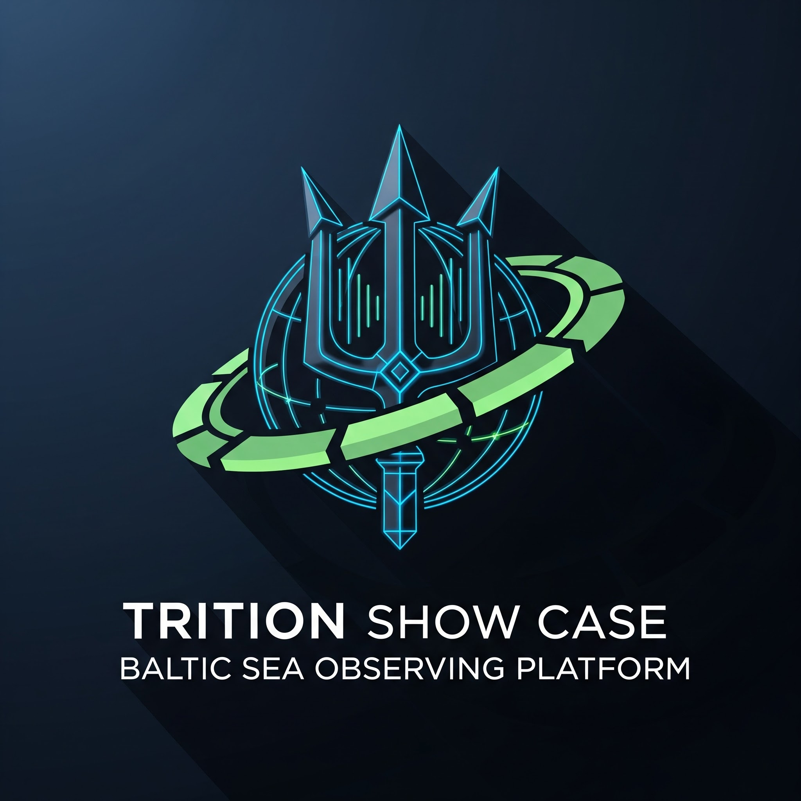

# triton
Show case - Baltic Sea Observer

## CML environment variables

Template for **Project → Environment Variables** (and Applications): [`.env.default`](./.env.default).  
Copy names into CML; set **passwords and API keys only in the CML UI**, not in git.

## NATO UI MVP

Standalone web app (Lagebild · Analysen · **Agenten**/CrewAI) with Impala `defense` backend and sample-data fallback:

- Code: [`triton-nato-ui/`](./triton-nato-ui/)
- UI data map: [`triton-nato-ui/docs/UI_OVERVIEW.md`](./triton-nato-ui/docs/UI_OVERVIEW.md)
- Runbook: see project docs `triton-mvp-runbook.md`

## Next Best Action (UC2, planned)

- Plan: [`cai-workbench/next-best-action/IMPLEMENTIERUNGSPLAN.md`](./cai-workbench/next-best-action/IMPLEMENTIERUNGSPLAN.md)
- Mission Planning + SAP D&S: [`docs/IMPLEMENTIERUNGSPLAN_MISSION_SAP.md`](./docs/IMPLEMENTIERUNGSPLAN_MISSION_SAP.md)
- Trino Iceberg snapshots (live matrix): [`cdw-analyse/README_iceberg_snapshots_trino.md`](./cdw-analyse/README_iceberg_snapshots_trino.md)
