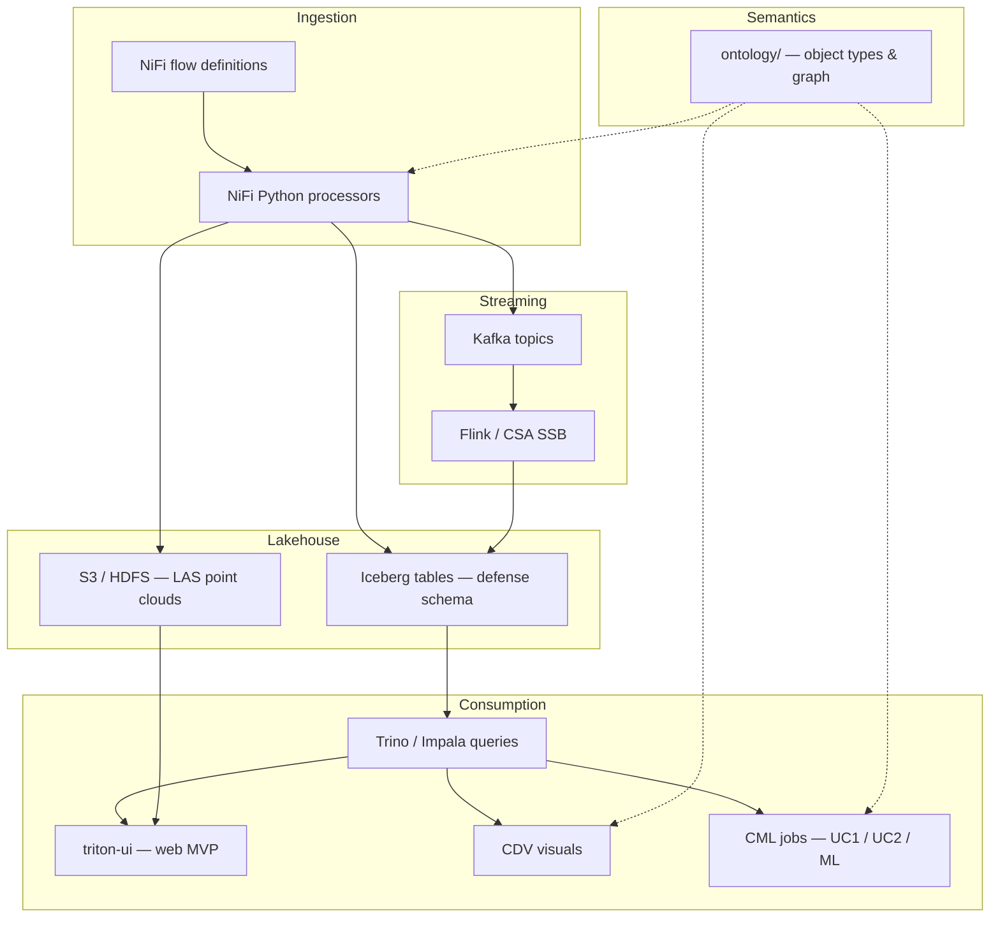

# Triton — Baltic Sea Observer

**Triton** is an end-to-end demonstration and reference implementation for **maritime situational awareness** in the **Baltic Sea**. It connects simulated and analytic data (AIS, naval fleet positions, buoys, LiDAR point clouds, STANAG-style surveillance traffic, and configurable business rules) on a **Cloudera Data Platform (CDP)** stack: **Apache NiFi** ingestion, **Kafka**, **Apache Iceberg** on the **defense** hive catalog, **Trino** / **Impala**, **Cloudera Streaming Analytics (Flink)**, **Cloudera Data Visualization (CDV)**, and **Cloudera Machine Learning (CML)** for agents, reporting, and ML.

The repository is organized as a **modular monorepo**: each top-level folder is a deployable or runnable component with its own README and runbooks.

---

## What the demo delivers

| Capability | Description |
|------------|-------------|
| **Lagebild** | Operational situation picture — live AIS, simulated naval fleet overlays, restricted areas, infrastructure, compliance flags, and NBA incident markers. |
| **Streaming analytics** | Real-time geofencing (vessels within ~5 km of Baltic harbours) via Flink SQL and Iceberg sinks. |
| **Synthetic maritime traffic** | NiFi Python processors simulate civilian AIS, naval patrol patterns, fishing fleets, trade routes, buoys, LiDAR captures, GPS jamming, and STANAG-style reports into Kafka / object store / Iceberg. |
| **LiDAR workflow** | Simulated vessel LAS files in S3 with metadata in `defense.lidar_simulation_metadata`, ontology mappings, CDV dashboards, optional **vessel-type classifier** (CML). |
| **Situation reports (UC1)** | Hourly LLM-assisted situation-report PDFs and summaries from warehouse views, published to S3 for the UI. |
| **Next Best Action (UC2)** | Alert detection, COA scoring, CrewAI agents, human-in-the-loop approval in the UI, governance and Semantica RDF export (Trino-backed). |
| **Agent console** | CrewAI chat apps grounded on the Baltic ontology and business rules (Lage-Analyst, COA-Berater, Semantica-Kurator). |

---

## Architecture (data flow)

**Primary database:** `defense` (Iceberg where noted). DDL, analytics SQL, and Trino utilities live under [`cdw-analyse/`](./cdw-analyse/).

---

## Main modules

| Module | Path | Role |
|--------|------|------|
| **Web UI (MVP)** | [`triton-ui/`](./triton-ui/) | React + Vite SPA; Express API; Python bridges for Trino, Impala, S3 LAS, SITREP, NBA, and CrewAI agent chat. Hash routes: Lagebild, Analysen, Schiffsnähe, LiDAR, SITREP, Agenten, NBA HITL. |
| **CDW analytics & DDL** | [`cdw-analyse/`](./cdw-analyse/) | Hive/Impala/Trino table creation, sample and production analytics, outlier detection, vessel route GeoJSON, NBA SQL phases, Iceberg snapshot probes, Trino spatial AIS experiments. |
| **NiFi processors** | [`nifi-processors/`](./nifi-processors/) | Python extension bundle (`upload/`) for LAS simulation, Baltic ship routing, multi-fleet naval simulators, fishing/trade routes, buoys, messengers, STANAG generators; tests in `tests/`. |
| **NiFi flows** | [`nifi-flow/`](./nifi-flow/) | Exported Data Hub flow JSON (e.g. `proj_triton`, Triton Data Simulator), parameter groups, deployment shell helpers. |
| **Defense ontology** | [`ontology/`](./ontology/) | YAML semantic layer: object types, link graph, LiDAR column mappings, classification enums; ties NiFi attributes, Iceberg columns, and CDV parameters. |
| **CDV assets** | [`cdv/`](./cdv/) | Dashboard/visual export JSON, LiDAR dataset stub, HTML panel examples for metadata drill-down. |
| **CSA / Flink** | [`csa-flink/`](./csa-flink/) | Real-time geospatial analytics on cluster `triton-csa`: Kafka virtual tables, Sedona distance jobs, Iceberg sink for port proximity monitoring. |
| **Situation awareness (UC1)** | [`cai-workbench/situation-awareness/`](./cai-workbench/situation-awareness/) | CML scheduled job: query `lagebild` views, LLM narrative, situation-report PDFs, S3 artifact layout consumed by the UI. |
| **Next Best Action (UC2)** | [`cai-workbench/next-best-action/`](./cai-workbench/next-best-action/) | Alert rules, COA catalog, CrewAI persistence, Trino materialization, HITL artifacts, SAP readiness hooks; Greifswald demo scenario. |
| **Trino batch jobs** | [`cai-workbench/trino-jobs/`](./cai-workbench/trino-jobs/) | CML utilities to refresh Lagebild-oriented Trino views. |
| **LiDAR classifier** | [`cai-workbench/lidar-vessel-classifier/`](./cai-workbench/lidar-vessel-classifier/) | Train/deploy RandomForest on LAS features; S3-backed fit/predict for CML model serving. |
| **DAS cable classifier** | [`cai-workbench/das-cable-classifier/`](./cai-workbench/das-cable-classifier/) | Spectrogram/HDF5 threat typing (anchor drag, CUI) — pairs with `DasCableAcousticSimulator` NiFi output. |
| **Agent console bridge** | [`cai-workbench/agent-console/`](./cai-workbench/agent-console/) | Python chat bridge wired from `triton-ui` **Agenten** tab. |
| **CML agent tools** | [`cai-agent/`](./cai-agent/) | Reusable CrewAI tools: CDW SQL query, schema introspection, weather. |
| **RAG corpus** | [`cai-rag/`](./cai-rag/) | Static reference corpora (maritime operations notes, sample airspace bulletins) for retrieval-augmented prompts. |
| **Project docs** | [`docs/`](./docs/) | Cross-cutting plans: ontology business rules + Trino mapping, Mission Planning / SAP, CML CrewAI install notes. |
| **CML env automation** | [`scripts/cml/`](./scripts/cml/) | Apply project environment variables via Cloudera AI API v2. |

Deeper integration notes for the UI (tables, endpoints, layers): [`triton-ui/docs/UI_OVERVIEW.md`](./triton-ui/docs/UI_OVERVIEW.md).

---

## Web UI MVP (entry point for operators)

Standalone web application (**Lagebild · Analysen · Agenten · NBA HITL**) with **Trino** preferred, **Impala** fallback, and **embedded sample data** when the warehouse is unreachable.

| Resource | Link |
|----------|------|
| Code & quick start | [`triton-ui/README.md`](./triton-ui/README.md) |
| Data & views map | [`triton-ui/docs/UI_OVERVIEW.md`](./triton-ui/docs/UI_OVERVIEW.md) |
| API latency bench | [`triton-ui/docs/API_LATENCY.md`](./triton-ui/docs/API_LATENCY.md) |
| CML application | `triton-ui/entry.py` on `CDSW_APP_PORT` |

---

## Next Best Action (UC2)

Simulation-backed **Next Best Action** on the same `defense` schema and NiFi simulators, with optional CrewAI narratives and operator approval in the UI.

| Resource | Link |
|----------|------|
| Module README & CML job | [`cai-workbench/next-best-action/README.md`](./cai-workbench/next-best-action/README.md) |
| Implementation plan | [`cai-workbench/next-best-action/IMPLEMENTIERUNGSPLAN.md`](./cai-workbench/next-best-action/IMPLEMENTIERUNGSPLAN.md) |
| Mission Planning + SAP D&S | [`docs/IMPLEMENTIERUNGSPLAN_MISSION_SAP.md`](./docs/IMPLEMENTIERUNGSPLAN_MISSION_SAP.md) |
| Business rules + Trino | [`docs/ONTOLOGY_BUSINESS_RULES.md`](./docs/ONTOLOGY_BUSINESS_RULES.md) |
| Iceberg snapshots (Trino) | [`cdw-analyse/README_iceberg_snapshots_trino.md`](./cdw-analyse/README_iceberg_snapshots_trino.md) |

---

## CML environment variables

Template for **Project → Environment Variables** (and per-Application overrides): [`.env.default`](./.env.default).

Copy variable **names** into CML; set **passwords and API keys only in the CML UI**, never in git.

Bulk apply via API v2: [`scripts/cml/`](./scripts/cml/) (`set_project_environment.py` + local `triton-project.env.local` from [`triton-project.env.example`](./scripts/cml/triton-project.env.example)).

---

## Typical deployment order

1. Apply warehouse DDL from [`cdw-analyse/`](./cdw-analyse/) (`create_db_tables_*.sql`, `run_trino_ddl.py` for NBA phases).
2. Sync [`nifi-processors/upload/`](./nifi-processors/upload/) to the NiFi cluster; import flows from [`nifi-flow/`](./nifi-flow/).
3. Optional: start Flink geofence job per [`csa-flink/readme.md`](./csa-flink/readme.md).
4. Schedule UC1 (`cai-workbench/situation-awareness/cml_job.py`) and UC2 (`cai-workbench/next-best-action/cml_job.py`) on CML.
5. Deploy **triton-ui** as a CML Application or run locally with `npm run dev`.
6. Import CDV visuals from [`cdv/`](./cdv/) and wire datasets to `defense` tables.

---

## License & operations note

Triton is a **showcase** stack: simulated traffic, demo credentials patterns, and sample governance bundles are for lab and pilot environments. Harden authentication, network egress, and data classification before any production deployment.