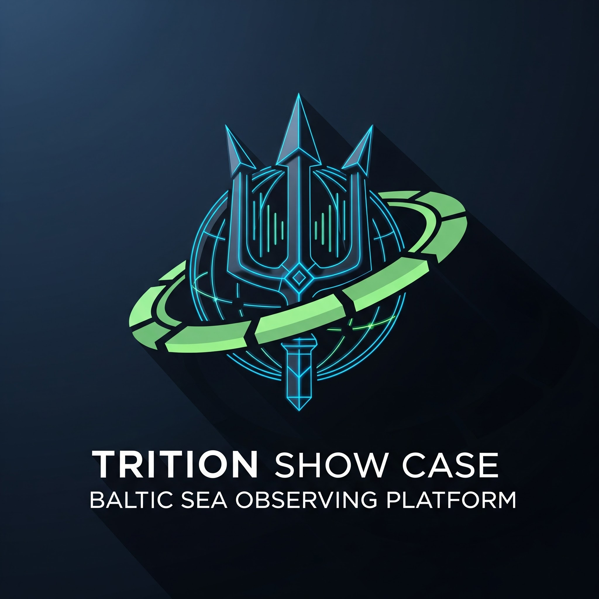

# triton
Show case - Baltic Sea Observer

## NATO UI MVP

Standalone web app (Lagebild · Analysen · SQL) with Impala `defense` backend and sample-data fallback:

- Code: [`triton-nato-ui/`](./triton-nato-ui/)
- Runbook: see project docs `triton-mvp-runbook.md`
