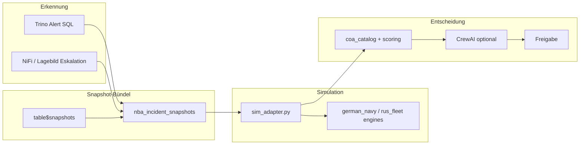

# Implementierungsplan: Simulationsgestützte agentische Next Best Action (NBA)

Stand: November 2026. Basiert auf Use Case 2 aus dem Architekturbericht, angepasst nach **Live-Trino-Probes** auf `cdw-triton` (siehe [`../../cdw-analyse/README_iceberg_snapshots_trino.md`](../../cdw-analyse/README_iceberg_snapshots_trino.md)).

## 1. Ziele und Abgrenzung

| Use Case | Bestehend | Neu |
| :---- | :---- | :---- |
| **UC1 Lagebild** | `cai-workbench/situation-awareness/` — View `lagebild`, Mistral-SITREP, stündlicher Job | unverändert weiterbetreiben |
| **UC2 NBA** | — | Alert → **Snapshot-Bündel** → Simulation → COA-Scoring → optional Agenten → HITL |

UC2 liefert **Handlungsbündel (COAs)** und Audit, kein Ersatz für das NATO-SITREP-PDF aus UC1. UC1 kann einen Alert aus UC2 als Zusatzkapitel referenzieren (später).

## 2. Architekturentscheidungen (verbindlich nach CDW-Trino)

Diese Punkte ersetzen Iceberg-**Branching** und `FOR SYSTEM_*` aus dem Konzeptbericht.

| Thema | Ursprüngliche Idee | **Angepasste Umsetzung auf cdw-triton** |
| :---- | :---- | :---- |
| Lagefixierung | Ein Iceberg-Branch pro COA-Simulation | **Snapshot-Bündel**: pro Incident mehrere `snapshot_id` auf **Basistabellen**, gespeichert in `nba_incident_snapshots` |
| Time Travel | `FOR VERSION AS OF` + Branch-Forks | Trino: `FOR VERSION AS OF <bigint>` oder `FOR TIMESTAMP AS OF TIMESTAMP '…'` auf Tabellen |
| Metadaten | `$snapshots` (Trino) | Syntax: `iceberg.defense."<table>$snapshots"` — **nicht** Hive `.snapshots` |
| Lagebild | Snapshot des Lagebilds | **Verboten**: `lagebild` / `lagebild_all_events` sind **Views** — Time-Travel-Klausel wirkt nicht zuverlässig |
| Branches anlegen | `CREATE BRANCH` / Hive `ALTER … CREATE BRANCH` | **Nicht unterstützt** am Trino-Connector („does not support creating branches“) |
| Rollback | `rollback_to_snapshot` im Flow | **Nicht** in Agenten-Jobs auf Produktivtabellen |
| Hive-Syntax | `FOR SYSTEM_VERSION` / `FOR SYSTEM_TIME` | **Nicht** auf Trino — nur `VERSION` / `TIMESTAMP` |

### Snapshot-Bündel (Kernmuster)

Bei Alert `t0` und `flow_uuid`:

1. Für jede registrierte **Fact-Tabelle** `T` (z. B. `ships`, `ais_events_ice`, später Readiness-Staging):
   ```sql
   SELECT snapshot_id, committed_at
   FROM iceberg.defense."T$snapshots"
   ORDER BY committed_at DESC
   LIMIT 1;
   ```
2. Zeilen in `iceberg.defense.nba_incident_snapshots` (neu): `(flow_uuid, table_name, snapshot_id, committed_at_utc)`.
3. Alle Lese-Queries der Simulation nutzen:
   ```sql
   SELECT … FROM iceberg.defense.ships
   FOR VERSION AS OF <snapshot_id_aus_bündel>
   ```
4. **Materialisierung (optional, Phase 2):** `CREATE TABLE … AS SELECT … FOR VERSION AS OF …` → `nba_mat_<flow_uuid>_<table>` für wiederholbare COA-Läufe ohne erneutes Time Travel über große AIS-Tabellen.

Red-vs.-Blue-Simulation **forkt** damit nicht Iceberg, sondern **Zustand + Mat-Tabellen** oder **Parquet unter** `artifacts/nba/<flow_uuid>/`.

## 3. Ziel-Logikfluss



## 4. Phasen und Lieferobjekte

### Phase 0 — Fundament (ohne LLM/CrewAI)

**Ziel:** Incident + Snapshot-Bündel + manuelles COA-Scoring.

| Aufgabe | Ort | Details |
| :---- | :---- | :---- |
| DDL `nba_incidents`, `nba_incident_snapshots`, `nba_coa_runs` | `cdw-analyse/sql/nba_schema_trino.sql` | Iceberg-Tabellen oder Hive-Iceberg wie bestehendes `defense`-Schema |
| Snapshot-Erfassung | `cai-workbench/next-best-action/src/snapshot_bundle.py` | Liste konfigurierbarer Fact-Tables (YAML/Env) |
| Alert-Regeln v1 | `alert_rules.py` + SQL aus `cdw-analyse/trino-spatial-ais/sql/queries/08_ais_blackout_pipelines.sql` | Deterministischer Einstieg |
| COA-Katalog + Scoring | `coa_catalog.py`, `scoring.py` | Vier Optionen analog Bericht (A–D), Gewichte Latenz/Entdeckung/Eskalation |
| Golden-Path-Test | `tests/test_greifswald_scenario.py` | Greifswald/Adlergrund, ETA aus `german_navy_mission_engine` |
| CML-Entry | `run_nba.py` | analog `situation-awareness/run_hourly.py` |

**Wiederverwendung:** `situation-awareness/src/data_access.py` (Trino-Connect), `nifi-processors/upload/german_navy_mission_engine.py` (Import wie in `nifi-processors/tests/`).

### Phase 1 — Simulation Adapter

| Aufgabe | Details |
| :---- | :---- |
| `sim_adapter.py` | Liest Snapshot-Bündel; replay 1–N Ticks `update_german_navy_movements` / Red-Gegenbewegung |
| Transit-ETA | `marine_fleet_registry`, `baltic_ship_routing` — keine neuen Geodätik-Formeln |
| Umwelt-Gate | Stub → später External DB (Copernicus/DWD); erst harte Schwellen aus Config |
| Artefakte | `artifacts/nba/<flow_uuid>/audit.json`, `coa_matrix.json` |

**Explizit nicht:** Iceberg-Branches, `rollback_to_snapshot` auf `ships`/`ais_events_ice`.

### Phase 2 — Ereignisgesteuerter CML-Job

- Job neben `run_hourly.py`: Trigger über CML Schedule **oder** INSERT in `nba_incidents` (status `NEW`).
- Optional: Webhook von `triton-nato-ui` (Phase 4).

### Phase 3 — Agenten (CrewAI Flow)

- Pydantic `MaritimeIncidentState`, `@persist` unter `artifacts/nba/`.
- LLM wie UC1: `llm_client`-Pattern, Triton OpenAI-kompatibel.
- **Regeln außerhalb LLM:** MC-362/UNCLOS zunächst als Python/JSON-Playbook; später Semantica SHACL.

### Phase 4 — UI & HITL

- `triton-nato-ui`: COA-Matrix, `approved_coa_id` zurück nach Trino.
- Verknüpfung SITREP: `LAGEBILD_PRECEDENCE_ESCALATED` als weicher Link zum NBA-Incident.

### Phase 5 — Governance & MCP (optional, CDP)

Nur wenn Workbench-MCP-Server produktiv:

| MCP | NBA-Nutzen |
| :---- | :---- |
| `iceberg-mcp-server-hive` | `$snapshots` / Bündel-Helper (kein Branch) |
| `ranger-mcp-server` | Rollentrennung OSINT / national |
| `data-marketplace-mcp-server` | Glossary / request_data_access |

**Semantica:** `run_shacl_validation`, PROV-O-Export; `semantica[crewai]` mit isoliertem CrewAI/Chroma-Pinning.

## 5. Konfiguration Fact-Tables für Snapshot-Bündel

Startliste (erweiterbar per `NBA_SNAPSHOT_TABLES`):

| Tabelle | Rolle im NBA-Kontext |
| :---- | :---- |
| `ships` | Flotte, Position, Readiness-Proxies |
| `ais_events_ice` | AIS-Verlauf, Blackouts |
| `baltic_sea_harbours` | selten versioniert — nur **current** oder seltenes Snapshot wenn sich Schema ändert |

Spatial/Pipeline-Alert-SQL bleibt in `cdw-analyse/trino-spatial-ais/`.

**Lagebild-Kontext für LLM:** Weiterhin Live-Query auf View `lagebild`; im Audit wird vermerkt: *„Lagebild nicht snapshot-pinned, Fact-Tables @ snapshot_ids …“*.

## 6. SQL-Vorlagen (Trino)

Snapshot-ID ermitteln:

```sql
SELECT snapshot_id, committed_at
FROM iceberg.defense."ais_events_ice$snapshots"
ORDER BY committed_at DESC
LIMIT 1;
```

Replay-Lesezugriff:

```sql
SELECT COUNT(*)
FROM iceberg.defense.ais_events_ice
FOR VERSION AS OF 7500014872264610121;
```

## 7. Risiken und Mitigation

| Risiko | Mitigation |
| :---- | :---- |
| Große AIS-Time-Travel-Queries | Materialisierung `nba_mat_*` pro Incident |
| View `lagebild` suggeriert falsche Reproduzierbarkeit | Bündel + Audit explizit; UC1 bleibt „aktuell“ |
| Branching-Wunsch aus Bericht | Nur Hive/Spark separat evaluieren, nicht Trino-Pfad |
| `rollback_to_snapshot` | Nur manuelle Ops, nicht Automatisierung |

## 8. Phase 0 Status

**Umgesetzt (Sprint 0):**

- `cdw-analyse/sql/nba_schema_trino.sql` + CML-Modul `cai-workbench/next-best-action/` (`run_nba.py`, Snapshot-Bündel, COA A–D, Tests).
- Live gegen `cdw-triton`: Snapshot-IDs aus `ships` / `ais_events_ice`, Best COA **A** (Greifswald-Demo).

**Als Nächstes (Phase 1):** `sim_adapter.py`, Alert-SQL aus Pipeline-Blackout, kein LLM.

Referenzen:

- Iceberg-Matrix: [`cdw-analyse/README_iceberg_snapshots_trino.md`](../../cdw-analyse/README_iceberg_snapshots_trino.md)
- Lagebild-UC1: [`../situation-awareness/README.md`](../situation-awareness/README.md)
- Probe: [`../../cdw-analyse/probe_iceberg_snapshots.py`](../../cdw-analyse/probe_iceberg_snapshots.py)