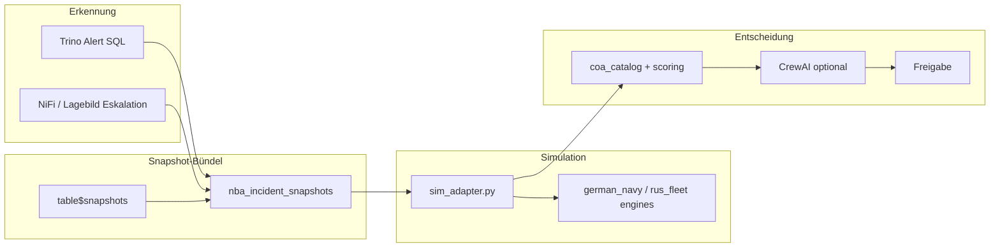

# Implementierungsplan: Simulationsgestützte agentische Next Best Action (NBA)

Stand: November 2026. Basiert auf Use Case 2 aus dem Architekturbericht, angepasst nach **Live-Trino-Probes** auf `cdw-triton` (siehe [`../../cdw-analyse/README_iceberg_snapshots_trino.md`](../../cdw-analyse/README_iceberg_snapshots_trino.md)).

## 1. Ziele und Abgrenzung

| Use Case | Bestehend | Neu |
| :---- | :---- | :---- |
| **UC1 Lagebild** | `cai-workbench/situation-awareness/` — View `lagebild`, Mistral-SITREP, stündlicher Job | unverändert weiterbetreiben |
| **UC2 NBA** | — | Alert → **Snapshot-Bündel** → Simulation → COA-Scoring → optional Agenten → HITL |

UC2 liefert **Handlungsbündel (COAs)** und Audit, kein Ersatz für das NATO-SITREP-PDF aus UC1. UC1 kann einen Alert aus UC2 als Zusatzkapitel referenzieren (später).

## 2. Architekturentscheidungen (verbindlich nach CDW-Trino)

Diese Punkte ersetzen Iceberg-**Branching** und `FOR SYSTEM_*` aus dem Konzeptbericht.

| Thema | Ursprüngliche Idee | **Angepasste Umsetzung auf cdw-triton** |
| :---- | :---- | :---- |
| Lagefixierung | Ein Iceberg-Branch pro COA-Simulation | **Snapshot-Bündel**: pro Incident mehrere `snapshot_id` auf **Basistabellen**, gespeichert in `nba_incident_snapshots` |
| Time Travel | `FOR VERSION AS OF` + Branch-Forks | Trino: `FOR VERSION AS OF <bigint>` oder `FOR TIMESTAMP AS OF TIMESTAMP '…'` auf Tabellen |
| Metadaten | `$snapshots` (Trino) | Syntax: `iceberg.defense."<table>$snapshots"` — **nicht** Hive `.snapshots` |
| Lagebild | Snapshot des Lagebilds | **Verboten**: `lagebild` / `lagebild_all_events` sind **Views** — Time-Travel-Klausel wirkt nicht zuverlässig |
| Branches anlegen | `CREATE BRANCH` / Hive `ALTER … CREATE BRANCH` | **Nicht unterstützt** am Trino-Connector („does not support creating branches“) |
| Rollback | `rollback_to_snapshot` im Flow | **Nicht** in Agenten-Jobs auf Produktivtabellen |
| Hive-Syntax | `FOR SYSTEM_VERSION` / `FOR SYSTEM_TIME` | **Nicht** auf Trino — nur `VERSION` / `TIMESTAMP` |

### Snapshot-Bündel (Kernmuster)

Bei Alert `t0` und `flow_uuid`:

1. Für jede registrierte **Fact-Tabelle** `T` (z. B. `ships`, `ais_events_ice`, später Readiness-Staging):
   ```sql
   SELECT snapshot_id, committed_at
   FROM iceberg.defense."T$snapshots"
   ORDER BY committed_at DESC
   LIMIT 1;
   ```
2. Zeilen in `iceberg.defense.nba_incident_snapshots` (neu): `(flow_uuid, table_name, snapshot_id, committed_at_utc)`.
3. Alle Lese-Queries der Simulation nutzen:
   ```sql
   SELECT … FROM iceberg.defense.ships
   FOR VERSION AS OF <snapshot_id_aus_bündel>
   ```
4. **Materialisierung (optional, Phase 2):** `CREATE TABLE … AS SELECT … FOR VERSION AS OF …` → `nba_mat_<flow_uuid>_<table>` für wiederholbare COA-Läufe ohne erneutes Time Travel über große AIS-Tabellen.

Red-vs.-Blue-Simulation **forkt** damit nicht Iceberg, sondern **Zustand + Mat-Tabellen** oder **Parquet unter** `artifacts/nba/<flow_uuid>/`.

## 3. Ziel-Logikfluss



## 4. Phasen und Lieferobjekte

### Phase 0 — Fundament (ohne LLM/CrewAI)

**Ziel:** Incident + Snapshot-Bündel + manuelles COA-Scoring.

| Aufgabe | Ort | Details |
| :---- | :---- | :---- |
| DDL `nba_incidents`, `nba_incident_snapshots`, `nba_coa_runs` | `cdw-analyse/sql/nba_schema_trino.sql` | Iceberg-Tabellen oder Hive-Iceberg wie bestehendes `defense`-Schema |
| Snapshot-Erfassung | `cai-workbench/next-best-action/src/snapshot_bundle.py` | Liste konfigurierbarer Fact-Tables (YAML/Env) |
| Alert-Regeln v1 | `alert_rules.py` + SQL aus `cdw-analyse/trino-spatial-ais/sql/queries/08_ais_blackout_pipelines.sql` | Deterministischer Einstieg |
| COA-Katalog + Scoring | `coa_catalog.py`, `scoring.py` | Vier Optionen analog Bericht (A–D), Gewichte Latenz/Entdeckung/Eskalation |
| Golden-Path-Test | `tests/test_greifswald_scenario.py` | Greifswald/Adlergrund, ETA aus `german_navy_mission_engine` |
| CML-Entry | `run_nba.py` | analog `situation-awareness/run_hourly.py` |

**Wiederverwendung:** `situation-awareness/src/data_access.py` (Trino-Connect), `nifi-processors/upload/german_navy_mission_engine.py` (Import wie in `nifi-processors/tests/`).

### Phase 1 — Simulation Adapter

| Aufgabe | Details |
| :---- | :---- |
| `sim_adapter.py` | Liest Snapshot-Bündel; replay 1–N Ticks `update_german_navy_movements` / Red-Gegenbewegung |
| Transit-ETA | `marine_fleet_registry`, `baltic_ship_routing` — keine neuen Geodätik-Formeln |
| Umwelt-Gate | Stub → später External DB (Copernicus/DWD); erst harte Schwellen aus Config |
| Artefakte | `artifacts/nba/<flow_uuid>/audit.json`, `coa_matrix.json` |

**Explizit nicht:** Iceberg-Branches, `rollback_to_snapshot` auf `ships`/`ais_events_ice`.

### Phase 2 — Ereignisgesteuerter CML-Job (umgesetzt)

| Komponente | Ort |
| :---- | :---- |
| Pipeline-Blackout (Top-1) | `sql/alerts/pipeline_blackout_top1.sql` |
| Lagebild-Kandidaten | `sql/alerts/lagebild_nba_candidates.sql` |
| Detektion + Priorität | `src/alert_detector.py` |
| SITREP `ESCALATED` | `src/sitrep_bridge.py` |
| Dedupe / Idle | `alert_rules.py`, `NBA_DEDUPE_HOURS`, `--exit-if-quiet` |

CML: `python3 run_nba.py --no-demo --exit-if-quiet --persist-trino` (stündlich neben UC1).

- Optional später: Webhook von `triton-nato-ui` (Phase 4).

### Phase 3 — Agenten (umgesetzt, CrewAI-ready)

| Komponente | Ort |
| :---- | :---- |
| State | `maritime_incident_state.py` + `state_persist.py` → `incident_state.json` |
| Playbook | `data/rules_playbook.json`, `rules_engine.py` |
| LLM-Narrativ | `llm_client.py` (NBA_* oder LAGEBILD_*), `agent_flow.py` |
| Pipeline | `NBA_PHASE=3`, `run_nba.py --phase 3 --skip-llm` |

Vollständiger **CrewAI `@persist` Flow** optional später; aktuell deterministischer Flow + optional LLM.

### Phase 4 — UI & HITL (umgesetzt)

| Komponente | Ort |
| :---- | :---- |
| UI | `triton-nato-ui` Tab **NBA HITL** (`src/pages/NbaHitl.tsx`) |
| API | `GET /api/nba/incidents`, `…/coa-runs`, `POST …/approve` |
| Trino | `server/trino-bridge.py`, DDL `nba_schema_phase4_hitl.sql` |
| Persist | `approved_coa_id`, `sitrep_link` (`hitl.py`, `persistence.py`) |

### Phase 5 — Decision record in warehouse + live HITL (umgesetzt)

| Komponente | Ort |
| :---- | :---- |
| DDL | `cdw-analyse/sql/nba_schema_phase5_decision.sql` (`decision_record_json`, `grounding_json`) |
| Persist | `persistence.update_decision_artifacts` nach `decision_record.json` |
| UI | HITL §7 zeigt live `approved_*` aus `nba_incidents`; decision-record API: Trino → artifacts → sample |

**CML empfohlen:** `NBA_PHASE=3`, `NBA_PERSIST_TRINO=1`, `NBA_SKIP_LLM=0` (optional LLM).

### Phase 6 — Materialize + what-if doctrines (umgesetzt)

| Komponente | Ort |
| :---- | :---- |
| DDL | `nba_schema_phase6_materialize.sql` → `nba_materialized_tables` |
| CTAS | `materialize.py` — `nba_mat_<flow>_<table>` via `FOR VERSION AS OF` + `NBA_MAT_ROW_LIMIT` |
| Env | `NBA_MATERIALIZE=1` (with `NBA_PERSIST_TRINO=1` for registry rows) |
| What-if | `what_if_red_doctrines.json` — evasive / aggressive / cooperative replays in decision §9 |
| UI | HITL decision recorder shows mat tables + doctrine comparison |

### Phase 7 — Governance export + agent orchestration (umgesetzt)

| Komponente | Ort |
| :---- | :---- |
| Agents | `agent_orchestrator.py` — SimAnalyst + GovSeal steps (CrewAI hook) |
| PROV | `governance_export.py` → `governance_bundle.json`, `decision_record.prov.jsonld` |
| CLI | `run_nba.py --phase 7` |
| UI | HITL link to `GET …/governance-bundle` when artifacts exist |

### Phase 8 — MCP (Trino Iceberg + Semantica) & Agent hooks (geplant)

**Ziel:** Snapshot-Bündel, Ontologie und Decision Records über **Cursor MCP** statt nur JDBC-SQL; SHACL-Gate vor Persist.

**Einrichtung:** [`docs/MCP_CURSOR_SETUP.md`](docs/MCP_CURSOR_SETUP.md), [`.cursor/mcp.json.example`](../../.cursor/mcp.json.example) (Secrets **nicht** committen; für Triton `TRINO_SCHEMA=defense`).

#### 8.1 `iceberg-mcp-server-trino`

| Aspekt | Inhalt |
| :---- | :---- |
| Paket | [dipankarmazumdar/iceberg-mcp-server-trino](https://github.com/dipankarmazumdar/iceberg-mcp-server-trino) — `uvx --from git+https://github.com/dipankarmazumdar/iceberg-mcp-server-trino@main run-server` |
| Env | `TRINO_HOST`, `TRINO_PORT`, `TRINO_USER`, `TRINO_PASSWORD`, `TRINO_CATALOG=iceberg`, **`TRINO_SCHEMA=defense`** |
| Ersetzt | manuelle `$snapshots`-SQL in `snapshot_bundle.py` durch MCP-Tools |
| Bleibt | `FOR VERSION AS OF`, `nba_mat_*`; **keine** Iceberg-Branches |

**Lieferobjekte 8a:** `src/mcp_snapshot_bundle.py` (`NBA_USE_ICEBERG_MCP=1`); `mcp_audit.json` + `snapshot_capture_source` in `audit.json`; optional `requirements-mcp.txt`.

#### 8.2 Semantica MCP (`semantica-mcp`)

| Tool (MCP) | NBA-Nutzen |
| :---- | :---- |
| `record_decision` / `query_decisions` | Parallele Entscheidungskette zu HITL |
| `add_entity` / `extract_entities` | `baltic_ontology.json` → KG |
| `export_graph` | Neben `governance_bundle.json` |

**SHACL:** `run_shacl_validation` auf `decision_record`/`grounding` (Turtle) → blockiert `update_decision_artifacts` wenn `conforms=false`.

**Lieferobjekte 8b:** `data/decision_record.ttl` (SHACL shapes), Artifact `decision_record.ttl` + `shacl_report.json`; `NBA_SHACL_GATE=1` blockiert `update_decision_artifacts`; `tests/test_decision_shacl.py`.

#### 8.3 Cursor / CML

- **Cursor:** MCP für Snapshot-Debug, Ontologie, `find_precedents`.
- **CML:** `run_nba.py` unverändert; SHACL optional als Post-Step ohne MCP.

#### 8.4 Später (CDP)

| MCP | NBA-Nutzen |
| :---- | :---- |
| `ranger-mcp-server` | Rollentrennung OSINT / national |
| `data-marketplace-mcp-server` | Glossary |
| CrewAI `@persist` | Ersetzt schrittweise `agent_orchestrator.py` |

**Status:** Plan + Beispiel-MCP in Repo; Code-Adapter = nächste PRs.

## 5. Konfiguration Fact-Tables für Snapshot-Bündel

Startliste (erweiterbar per `NBA_SNAPSHOT_TABLES`):

| Tabelle | Rolle im NBA-Kontext |
| :---- | :---- |
| `ships` | Flotte, Position, Readiness-Proxies |
| `ais_events_ice` | AIS-Verlauf, Blackouts |
| `baltic_sea_harbours` | selten versioniert — nur **current** oder seltenes Snapshot wenn sich Schema ändert |

Spatial/Pipeline-Alert-SQL bleibt in `cdw-analyse/trino-spatial-ais/`.

**Lagebild-Kontext für LLM:** Weiterhin Live-Query auf View `lagebild`; im Audit wird vermerkt: *„Lagebild nicht snapshot-pinned, Fact-Tables @ snapshot_ids …“*.

## 6. SQL-Vorlagen (Trino)

Snapshot-ID ermitteln:

```sql
SELECT snapshot_id, committed_at
FROM iceberg.defense."ais_events_ice$snapshots"
ORDER BY committed_at DESC
LIMIT 1;
```

Replay-Lesezugriff:

```sql
SELECT COUNT(*)
FROM iceberg.defense.ais_events_ice
FOR VERSION AS OF 7500014872264610121;
```

## 7. Risiken und Mitigation

| Risiko | Mitigation |
| :---- | :---- |
| Große AIS-Time-Travel-Queries | Materialisierung `nba_mat_*` pro Incident |
| View `lagebild` suggeriert falsche Reproduzierbarkeit | Bündel + Audit explizit; UC1 bleibt „aktuell“ |
| Branching-Wunsch aus Bericht | Nur Hive/Spark separat evaluieren, nicht Trino-Pfad |
| `rollback_to_snapshot` | Nur manuelle Ops, nicht Automatisierung |

## 8. Phase 0 Status

**Umgesetzt (Sprint 0):**

- `cdw-analyse/sql/nba_schema_trino.sql` + CML-Modul `cai-workbench/next-best-action/` (`run_nba.py`, Snapshot-Bündel, COA A–D, Tests).
- Live gegen `cdw-triton`: Snapshot-IDs aus `ships` / `ais_events_ice`, Best COA **A** (Greifswald-Demo).

**Umgesetzt (Phase 1):** `sim_adapter.py` (Transit-ETAs, Red-vs.-Blue-Ticks, K130-Replay), `env_gates.py`, `simulation_trace.json`, Score-Blending nach Simulation.

**Als Nächstes (Phase 8):** `iceberg-mcp-server-trino` + `semantica-mcp` in Cursor verdrahten; Adapter `mcp_snapshot_bundle.py`; SHACL-Gate auf `decision_record`; optional CrewAI `@persist` (8.4).

Referenzen:

- MCP Phase 8: [`docs/MCP_CURSOR_SETUP.md`](docs/MCP_CURSOR_SETUP.md) · [Semantica MCP](https://docs.getsemantica.ai/reference/mcp_server/)
- Iceberg-Matrix: [`cdw-analyse/README_iceberg_snapshots_trino.md`](../../cdw-analyse/README_iceberg_snapshots_trino.md)
- Lagebild-UC1: [`../situation-awareness/README.md`](../situation-awareness/README.md)
- Probe: [`../../cdw-analyse/probe_iceberg_snapshots.py`](../../cdw-analyse/probe_iceberg_snapshots.py)