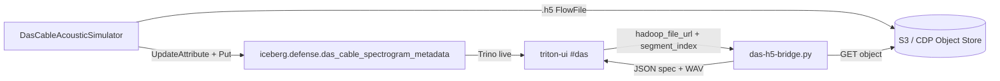

# DAS format — NiFi simulation processor and NATO UI

End-to-end reference for **synthetic DAS HDF5** from NiFi **`DasCableAcousticSimulator`**, metadata in **Iceberg**, and **spectrogram + audio** preview in **`triton-ui`** (`#das`).

Related:

| Topic | Document |
|--------|----------|
| NiFi → Iceberg attribute map | [`nifi-processors/docs/DAS_NIFI_METADATA_MAP.md`](../nifi-processors/docs/DAS_NIFI_METADATA_MAP.md) |
| Ontology / CDW columns | [`ontology/mappings/das_cable_spectrogram_metadata.yaml`](../ontology/mappings/das_cable_spectrogram_metadata.yaml) |
| ML classifier | [`cai-workbench/das-cable-classifier/README.md`](../cai-workbench/das-cable-classifier/README.md) |
| UI routes | [`triton-ui/docs/UI_OVERVIEW.md`](../triton-ui/docs/UI_OVERVIEW.md) § DAS |
| S3 preview on CML | [`triton-ui/APPLICATION_TROUBLESHOOTING.md`](../triton-ui/APPLICATION_TROUBLESHOOTING.md) § DAS HDF5 |

---

## 1. Pipeline (data flow)



1. NiFi builds one **HDF5 batch** (default **6 segments** per file).
2. **PutCDPObjectStore** stores the file and sets **`hadoop.file.url`** (or equivalent).
3. **PutDatabaseRecord** / Iceberg ingest writes **one metadata row per segment** (or one row per batch with a **primary** segment — see NiFi map doc).
4. The UI lists rows from Trino, then loads **`segments/seg_NNN`** inside the HDF5 for preview.

---

## 2. NiFi processor: `DasCableAcousticSimulator`

| Item | Value |
|------|--------|
| Source | [`nifi-processors/upload/DasCableAcousticSimulator.py`](../nifi-processors/upload/DasCableAcousticSimulator.py) |
| Engine | [`nifi-processors/upload/das_acoustic_engine.py`](../nifi-processors/upload/das_acoustic_engine.py) |
| Processor version | `1.3.0` |
| Output MIME | `application/x-hdf5` (or `application/json` for `json_preview`) |
| Schema attribute | `das.schema` = **`triton/das-cable/v1`** |

### Processor properties (defaults)

| Property | Default | Meaning |
|----------|---------|---------|
| Cable Asset | `BALTICCONNECTOR` | Corridor from EMODnet / `ostsee_infrastruktur` (also `PCABLE_BSH_*`, `NORD_STREAM_*`, `RANDOM`) |
| Segment Count | `6` | Windows along chainage (max 24 in code) |
| Channel Count | `48` | Spatial DAS channels per window |
| Window Seconds | `4` (max **`30`**) | Underwater time window per segment (1–30 s) |
| Sample Rate Hz | `2000` | Strain-rate sample rate |
| Random Seed | empty | Optional reproducibility |
| Output Format | `hdf5` | `hdf5` or `json_preview` (features only, no arrays) |

### FlowFile filename pattern

```text
das_{asset_lower}_{nseg}seg_{YYYYMMDDTHHMMSSZ}_{batch_uuid12}.h5
```

Example: `das_balticconnector_6seg_20261122T173553Z_8076c024d549.h5`

### Key FlowFile attributes (simulator)

| Attribute | Example | UI / Iceberg use |
|-----------|---------|------------------|
| `das.cable.asset` | `BALTICCONNECTOR` | `cable_asset` |
| `das.cable.id` / `das.cable.name` | catalog ids | `cable_id`, `cable_name` |
| `das.segment.index` | `2` | **`segment_index`** (which HDF5 group to preview) |
| `das.segment.lat` / `das.segment.lon` | WGS84 | Map + detail panel |
| `das.chainage_m` | `25141` | Chainage label |
| `das.threat_class` | `cable_strain_anomaly` | GT label (primary segment) |
| `das.channel.count` | `48` | Metadata |
| `das.window.seconds` | `4` | Demo audio fallback length |
| `das.fs_hz` | `2000` | Playback / physics |
| `das.threat.classes` | comma list | Batch summary only |
| `latitude` / `longitude` | centroid | Batch centroid (not table columns) |
| `filename` | see above | S3 key leaf name |

After object store put, ingest must include:

| Attribute / column | Required for UI live preview |
|--------------------|------------------------------|
| **`hadoop_file_url`** | **`s3a://bucket/.../file.h5`** (full URI) |
| **`segment_index`** | Integer matching HDF5 group `seg_NNN` |

See [`DAS_NIFI_METADATA_MAP.md`](../nifi-processors/docs/DAS_NIFI_METADATA_MAP.md) for UpdateAttribute copy-paste.

### Threat classes (ground truth in HDF5)

Defined in `das_acoustic_engine.THREAT_CLASSES`:

| Label | Typical acoustic fingerprint (sim) |
|-------|-----------------------------------|
| `ambient` | Background micro-vibration |
| `vessel_passage` | ~24 Hz swept envelope |
| `trawler_scrape` | ~88 Hz + scrape modulation |
| `anchor_drag` | ~5.5 Hz ramp |
| `cui_sabotage_tap` | ~340 Hz impulse |
| `cable_strain_anomaly` | ~1.2 Hz step strain |
| `anchor_slip` | Staccato anchor slip bursts on cable |
| `uboat_acoustic` | Low tonal cavitation / machinery (~14–38 Hz) |
| `whale_vocalization` | Chirped call sequences (~52 Hz band) |
| `hard_beep` | Sharp periodic beep (~620 Hz) |

Long windows (e.g. **30 s** at 2000 Hz → 60 000 samples/segment) increase HDF5 size; UI playback still caps at **10 s** (`DAS_PLAY_MAX_SEC`). Consider `DAS_H5_MAX_MB` on the Application if batches exceed default **48 MB**.

---

## 3. HDF5 on-disk format (`triton/das-cable/v1`)

Produced by `write_hdf5_batch()` in `das_acoustic_engine.py`.

### Root

| Path | Type | Content |
|------|------|---------|
| `@schema` | attr | `triton/das-cable/v1` |
| `@cable_id` | attr | e.g. `BC` |
| `@cable_name` | attr | human name |
| `@json_meta` | attr | JSON batch summary (segments list, fs, window, …) |

### Per segment: `segments/seg_{index:03d}/`

| Dataset / attr | Shape / type | Description |
|----------------|--------------|-------------|
| `channels` | **`(n_channels, n_samples)`** float | Multi-channel strain-rate window (`n_samples` = `window_s × fs_hz`, default 8000) |
| `spectrogram` | **`(n_freq, n_time)`** float32 | STFT magnitude of **channel mean** (`n_fft=256`, hop 64) |
| `frequencies_hz` | `(n_freq,)` float32 | RFFT bin centres (≤ Nyquist) |
| `@fs_hz` | float | Sample rate (default 2000) |
| `@threat_class` | string | Ground-truth label |
| `@chainage_m` | float | Along-cable position |
| `@latitude` / `@longitude` | float | Segment WGS84 |

**Segment IDs:** `seg_000`, `seg_001`, … — UI `segment_index` **2** → group **`seg_002`**.

**Layout contract for preview:** time series length is on the **long** axis of `channels` (channels × samples). The UI bridge (`das-h5-bridge.py`) auto-detects transposed layouts but ingest should follow **`(n_channels, n_samples)`**.

### JSON preview mode (`Output Format = json_preview`)

No binary arrays — only `batch_meta` + per-segment `summary_features()` (band powers, centroid, peak Hz, etc.). Use for NiFi testing without S3.

---

## 4. Iceberg table: `das_cable_spectrogram_metadata`

Qualified: **`iceberg.defense.das_cable_spectrogram_metadata`** (see `cdw-analyse/create_db_tables_trino.sql`).

Rows must expose at least:

- `hadoop_file_url`, `segment_index`, `segment_lat`, `segment_lon`
- `cable_asset`, `threat_class` (and optional `predicted_threat_type`, `model_confidence` from classifier)
- `channel_count`, `window_seconds`, `fs_hz`, `ingested_at`

The UI type is [`DasCableSegment`](../triton-ui/src/lib/das-cable.ts).

---

## 5. NATO UI (`#das`)

Build with DAS preview: check `/api/version` → `distDasPreview: true`, build ≥ `0.2.7-das-wav-api` (spectrogram + WAV API).

### Pages and components

| Piece | Role |
|-------|------|
| [`DasCable.tsx`](../triton-ui/src/pages/DasCable.tsx) | Segment list + map |
| [`DasCableDetail.tsx`](../triton-ui/src/components/DasCableDetail.tsx) | Metadata table |
| [`DasCablePreview.tsx`](../triton-ui/src/components/DasCablePreview.tsx) | Loads HDF5 preview |
| [`DasSpectrogramCanvas.tsx`](../triton-ui/src/components/DasSpectrogramCanvas.tsx) | Canvas colormap |

### HTTP API (Node → Python)

| Method | Path | Backend |
|--------|------|---------|
| GET | `/api/das-cable/segments` | Trino (+ sample fallback per data mode) |
| GET | `/api/das-cable/preview?hadoop_file_url=&segment_index=` | `das-h5-bridge.py` → JSON (downsampled spectrogram grid, metadata, optional base64 WAV) |
| GET | `/api/das-cable/wav?hadoop_file_url=&segment_index=` | Same bridge, **`audio/wav`** body (preferred in CML Application) |

Query param **`hadoop_file_url`**: full `s3a://` or `s3://` URI (must match stored Iceberg value).

### Preview behaviour

1. **Catalog row** supplies URI + `segment_index`.
2. Server fetches HDF5 from S3 (`s3_boto.py`, same credentials as LiDAR).
3. Bridge reads `segments/seg_NNN`, returns:
   - Spectrogram: ~**160×120** grid, row-wise contrast + log display scale (see bridge `display_floor` / `display_ceiling` in JSON).
   - Audio: channel-mean waveform, **≤10 s** (`DAS_PLAY_MAX_SEC`), resampled to **8 kHz** (`DAS_AUDIO_TARGET_FS`).
4. If S3 or HDF5 fails → stylized **demo** spectrogram + synthetic tone; error + S3 hint in panel.

### S3 / CML Application env

| Variable | Purpose |
|----------|---------|
| Project **Data Connection** “S3 Object Store” | Preferred on CML |
| `LIDAR_USE_CML_S3=auto` | Treat project connection as configured |
| `S3_DAS_ALLOWED_PREFIX` | Optional allowlist for DAS URIs |
| `DAS_H5_MAX_MB` | Max HDF5 download (default 48) |

Smoke (CML session):

```bash
python3 triton-ui/server/das-h5-bridge.py 's3a://bucket/.../das_....h5' 2
curl -sS -o /tmp/das.wav "http://127.0.0.1:\$CDSW_APP_PORT/api/das-cable/wav?hadoop_file_url=..."
```

### Threat colours (map / list)

From [`das-cable.ts`](../triton-ui/src/lib/das-cable.ts): e.g. `cui_sabotage_tap` red, `vessel_passage` blue, `cable_strain_anomaly` purple.

---

## 6. NBA integration (optional)

Live DAS rows with high threat feed **NBA** alert detection (`das_cable_threat` SQL) when `NBA_DAS_CABLE_THREAT=1` — see [`cai-workbench/next-best-action/sql/alerts/das_cable_threat_top1.sql`](../cai-workbench/next-best-action/sql/alerts/das_cable_threat_top1.sql).

---

## 7. Checklist for operators

| Step | Verify |
|------|--------|
| NiFi HDF5 | `das.schema=triton/das-cable/v1`, file on S3 |
| Metadata | `hadoop_file_url` + `segment_index` on every UI row |
| Trino | `SELECT hadoop_file_url, segment_index FROM iceberg.defense.das_cable_spectrogram_metadata LIMIT 5` |
| UI build | `/api/version` shows DAS preview build + `distDasPreview` |
| S3 on app | `/api/health` → `das.s3Configured: true` |
| Segment match | UI “S3 · seg *N*” matches `seg_NNN` in HDF5 |

---

*Simulator version and UI build stamps change independently — align NiFi processor JAR/Python upload with the `triton-ui` git revision you deploy on CML.*