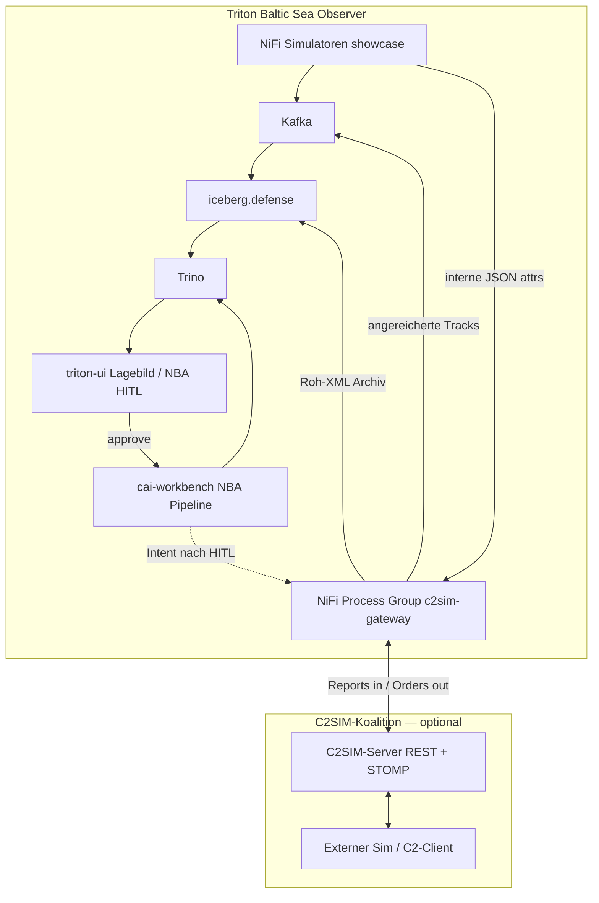

# Implementierungsplan: C2SIM-Server und Triton-Integration (SISO-STD-019-2020)

Stand: November 2026 · Repository: **Triton Baltic Sea Observer**  
Verwandte Pläne: [NBA UC2](../cai-workbench/next-best-action/IMPLEMENTIERUNGSPLAN.md) · [Mission Planning SAP](./IMPLEMENTIERUNGSPLAN_MISSION_SAP.md) · [NATO UI](../triton-ui/docs/UI_OVERVIEW.md) · [NiFi Simulatoren](../nifi-processors/upload/README.md)

---

## 1. Executive Summary — was der C2SIM-Server **nicht** tut

Ein **C2SIM-Server** (z. B. OpenC2SIM Reference Implementation) **erzeugt keine maritime Simulation** und **berechnet keine Schiffsbewegungen**. Er ist ein **Koalitions-Nachrichten-Hub** gemäß **SISO-STD-019-2020**:

| Funktion | C2SIM-Server | Triton (Ist) |
| :---- | :---- | :---- |
| Physik / Tracks | **Nein** — nur Verteilung von XML | **Ja** — NiFi-Python-Engines (`german_navy_mission_engine`, AIS-Routing, `rus_fleet_sim_engine`, …) |
| Szenario-Inhalt | Speichert/weiterleitet **C2SIMInitialization** / MSDL-Übersetzung | `proj_triton_showcase` + Registries (`marine_fleet_registry`, `rus_fleet_registry`, …) |
| Befehle | Nimmt **OrderBody** entgegen, publiziert an Federates | NBA **HITL** + geplantes SAP Readiness; intern Mission-Properties in NiFi |
| Lage | **ReportBody** (Position/Observation) an alle Subscriber | Kafka → Iceberg → Trino → **Lagebild** |

**Kurz:** Die **Simulation** in Triton ist das **CDP-Datenökosystem** (NiFi → Lakehouse). Der **C2SIM-Server** ist optional die **Übungs-Schnittstelle** nach außen (CWIX, VR-Forces, nationale C2-Clients) — oder ein **Adapter**, der dieselben Ereignisse in C2SIM-XML spiegelt.

---

## 2. Rollenmodell: wer erzeugt welche „Simulation“?

### 2.1 Simulationsquellen in Triton (ohne C2SIM)

| Quelle | Pfad | Output | Lagebild-Bezug |
| :---- | :---- | :---- | :---- |
| Zivile AIS | `ShipSimulationRoutesGemini.py` | Kafka / Iceberg `ships`, AIS-Pipeline | Layer **AIS Live** |
| Deutsche Marine | `MarineShipSimulator.py` + `german_navy_mission_engine.py` | Flottenpositionen | **DEU Fleet** |
| Russische Flotte | `RusFleetPositionSimulator.py` | `rus_fleet` | **RUS Fleet** |
| Handel / Fischerei | `NorthSeaBalticTradeSimulator.py`, `FishingBoatSimulator.py` | AIS-Events | Analysen, Outliers |
| STANAG-Lage | `STANAGSimulator.py` | `marine_surveillance_reports` | KPI Surveillance |
| NBA / COA | `cai-workbench/next-best-action/src/sim_adapter.py` | ETA, Red/Blue — **kein** Live-Feed | COA-Matrix, keine Federate |
| LiDAR / Buoys / DAS | `LidarSimulator.py`, `BojenSensorSimulator.py`, `DasCableAcousticSimulator.py` | S3 + Metadaten-Tabellen | LiDAR / Buoy-Tabs |

Diese Komponenten **ersetzen** in der Demo die Rolle eines **Simulation Federate** — ohne XML an einen C2SIM-Server zu senden.

### 2.2 Was ein C2SIM-Server konkret macht (OpenC2SIM-Referenz)

Laut Referenzimplementierung ([OpenC2SIM Server Docs](https://openc2sim.github.io/)):

1. **REST ingest** — `POST` von C2SIM-XML (Initialization, Orders, Reports, System Commands).
2. **Validierung / Dialekt** — XSD, Versionen (u. a. CWIX-Profile wie C2SIM_CWIX2022v1.2).
3. **Zustandsautomat** — z. B. `UNINITIALIZED` → `INITIALIZED` → `RUNNING` / `PAUSED`.
4. **STOMP publish** — Broadcast an Topics (klassisch `/topic/C2SIM`) für alle Clients.
5. **Optional** — Übersetzung zwischen Legacy-Dialekten (MSDL, CBML-Light, …).

**Echte Simulatoren** (MAK VR-Forces, OneSAF, tactics21, nationale C2-Führungsmittel) sind **Clients**: sie **posten Reports** und **konsumieren Orders**. Der Server ist **Föderations-Bus**, vergleichbar mit einem HLA-RTI nur auf C2/BML-Ebene (niedrigere Zeitauflösung als DIS/HLA).

### 2.3 Triton in der C2SIM-Welt — drei logische Rollen

| Rolle | Beschreibung | Empfehlung für Ostsee-Demo |
| :---- | :---- | :---- |
| **A — Datenplattform (immer)** | Lakehouse + Lagebild + NBA | Kerngeschäft, unabhängig von C2SIM |
| **B — Simulation-Adapter (optional)** | NiFi-Subflow liest interne Tracks, sendet **ReportBody** an C2SIM | CWIX-Sichtbarkeit ohne VR-Forces |
| **C — C2-Client-Proxy (optional)** | Nach NBA-Freigabe: **OrderBody** / **StartScenario** an Server | Nur mit externem Federate oder zweitem Nation-Client |
| **D — Externer Federate (optional)** | VR-Forces o. Ä. am selben Server | Architektur-Referenz, nicht Repo-Pflicht |

**Moduswahl:**

- **Modus „Triton-only“** (Standard): kein C2SIM-Server; Showcase wie heute.
- **Modus „Spiegel“**: Server + Rolle B — Triton **feeds** C2SIM aus synthetischen Daten (Lage für Partner).
- **Modus „Föderiert“**: B + C + D — Triton **befiehlt** begrenzt, Partner simuliert fein-granular.

---

## 3. Zielarchitektur: Zusammenarbeit C2SIM ↔ Triton



**Integrationsprinzip:** Alles, was das **Lagebild** speisen soll, landet weiter in **`iceberg.defense`** — nicht parallel nur im C2SIM-Bus. C2SIM ist **zusätzlicher Kanal**, nicht Ersatz für Trino.

---

## 4. Nachrichten- und Zustandslogik (für Triton-Entwickler)

### 4.1 Relevante C2SIM-Nachrichtentypen

| Nachricht | Richtung (Triton-Adapter) | Triton-Entsprechung |
| :---- | :---- | :---- |
| `C2SIMInitialization` / `ShareScenario` | Empfangen (von extern) oder **generieren** aus Fleet-Registries | Export-Skript: `german_navy_fleet` + `rus_fleet_registry` → `AbstractObject` + UUIDs |
| `StartScenario` / `PauseScenario` / `StopScenario` | Senden **oder** Empfangen | NiFi: Start/Stop Process Groups; `BalticShipRouteStateReset.py` bei Reset |
| `ReportBody` (Position/Observation) | **Senden** (Modus Spiegel) oder Empfangen (Modus Föderiert) | Zeilen in `ais_events_ice` / Fleet-Tabellen; UI-APIs unverändert |
| `OrderBody` | **Senden** nur nach HITL | Mapping COA → Task; siehe §5.3 |
| `ResetScenario` | Empfangen | Entity-Cache leeren + Route-Reset + NBA-Snapshot-Hinweis im Audit |

### 4.2 Server-Zustand vs. Triton-Orders

Der Server **lehnt OrderBody** oft ab, wenn Status ≠ `RUNNING`. Der NiFi-Send-Flow muss:

1. `GET …/status` **oder** auf `StartScenario`-Echo im STOMP-Stream warten.
2. Fehler `400` mit Status `PAUSED` → Operator-Hinweis in **NBA**-Audit, kein stiller Retry.

### 4.3 STANAG vs. C2SIM (im Repo)

| | STANAG-Sim (`STANAGSimulator.py`) | C2SIM |
| :---- | :---- | :---- |
| Zweck | Operative **Meldungslage** (HQ ↔ Einheit) | **Übungssteuerung** + standardisierte Orders/Reports |
| Speicher | `marine_surveillance_reports` | Roh `c2sim_xml_archive` (neu) + optional Staging |
| UI | KPI Surveillance, Agenten-Kontext | **Kein** direktes UI-Widget in Phase 1 — Lage über Trino |

Kein automatisches Merge STANAG-Text → C2SIM ohne expliziten Mapper.

---

## 5. Integrationspunkte im Repository

### 5.1 Empfang: Reports → Lakehouse (NiFi `c2sim-gateway` Receive)

| Schritt | Komponente | Konfiguration |
| :---- | :---- | :---- |
| 1 | STOMP Consumer | `stomp.py` / NiFi 2.x Python Processor; Topic `/topic/C2SIM`; Heartbeat `10000,10000` |
| 2 | `ValidateXml` | XSD aus [C2SIMArtifacts](https://github.com/OpenC2SIM/C2SIMArtifacts); Namespace `http://www.sisostds.org/schemas/C2SIM/1.1` in XPath registrieren |
| 3 | Routing | `ReportBody` → Split `ReportContent` → XSLT → **Triton-Track-JSON** (internes Schema, siehe §7) |
| 4 | Entity-Lookup | Iceberg `defense.c2sim_entity_map` + NiFi DistributedMapCache |
| 5 | Persistenz | `PutKafka` / bestehende Sink-Prozessoren wie AIS-Flow; Raw-XML → `c2sim.events.raw` |
| 6 | Merge | SQL/Trino-Job oder NiFi: Staging → `ships` / Fleet-Update (MMSI als Join-Schlüssel) |

**Abnahme:** Lagebild-Karten **DEU/RUS/AIS** zeigen Federate-Tracks **ohne** UI-Codeänderung (nur Datenherkunft).

### 5.2 Spiegel: interne Simulatoren → Reports (Modus Spiegel)

Option für CWIX ohne externen Simulator:

- Nach `MarineShipSimulator` / `RusFleetPositionSimulator`: **AttributesToJSON** → kleiner Python-Processor `C2simReportMirror.py` (neu, geplant) baut minimalistischen `ReportBody` aus Lat/Lon/UUID.
- Post an `http://c2sim-server:8080/…/c2sim?clientID=TRITON_NIFI&protocol=C2SIM&version=1.1`.

Der Server **verteilt** diese Reports an externe Subscriber — Triton bleibt **Author** der Bewegungslogik.

### 5.3 Senden: NBA / Mission → Orders (Modus Föderiert)

| Stufe | Ort heute | C2SIM-Erweiterung |
| :---- | :---- | :---- |
| Entscheidung | `triton-ui` `POST …/approve` | unverändert |
| Audit | `decision_record.py` | Abschnitt `11_c2sim_dispatch` (geplant) |
| Intent | `docs/IMPLEMENTIERUNGSPLAN_MISSION_SAP.md` MP-3 | SAP-Gate **vor** OrderBody |
| Übersetzung | — | `c2sim_order_mapper.py`: `approved_coa_id` → `TaskActionCode`, Wegpunkte aus `sim_adapter` / Grokswald-Szenario |
| Transport | — | NiFi `InvokeHTTP` POST XML |
| Interne Ausführung | `german_navy_mission_engine` Property-Inject | **Parallel**: Order an Server **und** NiFi-Mission-Update (Dual-Execution vermeiden — Feature-Flag `C2SIM_EXECUTE_ORDERS=true`) |

**Human-in-the-Loop:** Niemals direkt vom KI-Agenten (`Agenten`-Tab) nach C2SIM — nur nach gleicher Freigabe wie NBA.

### 5.4 Entity-Mapping (Ostsee)

| Triton-Feld | C2SIM-Feld | Beispiel |
| :---- | :---- | :---- |
| `ships.mmsi` | nicht in C2SIM-Core → Extension-Attribut | `211123456` |
| NiFi `unit_index` / Registry-ID | `AbstractObject` UUID | stabil pro Showcase-Deploy |
| `triton:…` Ontologie | `Name` / `SymbolIdentifier` | `triton:german_navy_unit` |
| COA Capability | `TaskActionCode` | Mapping-Tabelle in `docs/c2sim_coa_task_map.yaml` (geplant) |

Bei `ResetScenario`: truncate `c2sim_entity_map` + `BalticShipRouteStateReset` + MapCache-Delete.

---

## 6. Phasenplan (überarbeitet, repo-orientiert)

Kein 6-Wochen-Greenfield nur für C2SIM — gekoppelt an NBA/SAP-Reife.

### CG-0 — Konzept & Contracts (1 Sprint, ohne Server)

| Lieferobjekt | Ort |
| :---- | :---- |
| Rollenentscheid Modus A/B/C | dieses Dokument + Projekt-ADR |
| Internes Track-JSON-Schema | `docs/c2sim_triton_track.schema.json` (geplant) |
| COA→Task-Mapping | `docs/c2sim_coa_task_map.yaml` (geplant) |
| DDL-Staging | `cdw-analyse/sql/c2sim_staging_trino.sql` (geplant): `c2sim_entity_map`, `c2sim_xml_archive`, `c2sim_report_staging` |

**Akzeptanz:** Team einigt sich: Showcase bleibt Modus A bis CWIX-Termin.

### CG-1 — Lakehouse-Staging & Spiegel (2 Sprints, Modus B)

| Aufgabe | Details |
| :---- | :---- |
| NiFi PG `c2sim-gateway` nur **Outbound Mirror** | Kein STOMP nötig für Minimal-Demo |
| C2SIM-Server in Docker neben DF-Test | OpenC2SIM 4.8.x, ActiveMQ/Artemis |
| Initialization aus Registries | Einmaliges XML-Artifact `scenarios/baltic_greifswald_c2sim_init.xml` (geplant) |
| Trino-View | `lagebild_c2sim_provenance` — optional Filter „source=c2sim” |

**Akzeptanz:** Externer STOMP-Testclient sieht Position-Reports; Triton-Lagebild unverändert korrekt.

### CG-2 — Vollständiger Receive + Archiv (2 Sprints)

| Aufgabe | Details |
| :---- | :---- |
| STOMP Consumer + XSD-Quarantäne | `invalid_c2sim` Route |
| Kafka `c2sim.events.raw` + Iceberg Archiv | AAR / NBA Time-Travel ergänzend |
| MERGE in `ships` / Fleet | MMSI-Pflicht für Join |

**Akzeptanz:** Report von VR-Forces (oder Testclient) erscheint auf Lagebild innerhalb SLA (z. B. &lt; 30 s End-to-End).

### CG-3 — NBA → OrderBody (2–3 Sprints, Modus C)

| Aufgabe | Details |
| :---- | :---- |
| `c2sim_order_mapper` + Feature-Flag | `NBA_C2SIM_MODE=off|mirror|federate` |
| UI | HITL: Checkbox „Übung an C2SIM-Föderation senden” |
| MP/SAP | Order nur wenn `sap_readiness_ok` (siehe Mission-SAP MP-1) |

**Akzeptanz:** Greifswald-Demo: approve COA B → ein OrderBody → Server RUNNING → Report zurück → Incident-Audit §11.

### CG-4 — Betrieb, Security, Last (fortlaufend)

| Thema | Maßnahme |
| :---- | :---- |
| TLS | mTLS zwischen NiFi ↔ C2SIM, STOMP 61614 |
| Last | 50+ Entities: Showcase-Flow + Server-Statistik (OpenC2SIM Response-Time-Collection) |
| DDIL | Archiv in Iceberg; disconnected nur Lagebild Sample-Modus (`TRITON_FORCE_SAMPLE_DATA`) |

---

## 7. Kanonisches Zwischenschema (Triton-Track-JSON)

Vorgabe für alle Mapper (C2SIM ↔ NiFi ↔ Iceberg) — **ein** Schema, kein paralleles CoT im MVP:

```json
{
  "event_id": "uuid",
  "observed_at_utc": "2026-11-20T12:00:00Z",
  "entity_uuid": "c2sim-uuid",
  "mmsi": 211123456,
  "name": "FGS …",
  "side": "BLUE",
  "lat": 54.12,
  "lon": 13.45,
  "heading_deg": 270,
  "speed_kn": 12.5,
  "source": "c2sim_report | nifi_marine | nifi_ais",
  "flow_uuid": "optional-nba-incident"
}
```

Iceberg-Zieltabellen: bestehende **Fact**-Tabellen; Provenance-Spalte `c2sim_entity_uuid` optional per DDL-Migration.

---

## 8. Abnahme-Workflow (End-to-End, Modus Föderiert)

| Schritt | Akteur | Aktion |
| :---- | :---- | :---- |
| 1 | NiFi | Showcase läuft; optional Mirror aktiv |
| 2 | Operator | Lagebild: Anomalie / NBA-Greifswald |
| 3 | NBA | COA-Matrix + `sim_adapter` ETA |
| 4 | SAP (Sample) | Readiness-Gate grün (MP-1) |
| 5 | Kommandeur | HITL approve + C2SIM-Flag |
| 6 | NiFi Gateway | OrderBody POST, Status RUNNING |
| 7 | Federate | ReportBody → Gateway → Iceberg |
| 8 | Operator | Lagebild-Update + Decision Record §11 + Roh-XML in Archiv |

---

## 9. Risiken & bewusste Nicht-Ziele

| Risiko | Mitigation |
| :---- | :---- |
| Doppelte Wahrheit (NiFi vs. C2SIM) | `source`-Spalte; Modus A Default |
| XPath ohne Namespace | XSD + registrierte Namespaces in jedem NiFi-Schritt |
| Order vor RUNNING | Status-Poll / Wait-on-STOMP |
| C2SIM ersetzt `sim_adapter` | **Verboten** — NBA-Simulation bleibt Python-Adapter |

**Nicht-Ziele (Showcase):** Volles JC3IEDM; HLA/DIS-Bridge; SAP-Schreiben via C2SIM; öffentliches CoT-Feed ohne Trino.

---

## 10. Glossar

| Begriff | Bedeutung |
| :---- | :---- |
| **C2SIM** | SISO-STD-019 — XML-Austausch C2 ↔ Simulation ↔ RAS |
| **Federate** | Client, der Orders ausführt und Reports sendet (**Triton NiFi = synthetischer Federate**) |
| **Server** | Nachrichten- und Szenario-Hub (**kein Simulator**) |
| **MSDL** | Military Scenario Definition Language — Initialisierung, übersetzbar vom Server |

---

## 11. Änderungshistorie zum Ursprungsplan (DOCX)

| Ursprung | Anpassung in Triton |
| :---- | :---- |
| Kafka `triton.maritime.tracks` | An bestehende DF-Sinks und `ais_events_ice` koppeln |
| Redis-only UUID-Cache | Iceberg `c2sim_entity_map` + Cache |
| tactics21 / VR-Forces Pflicht | Optional in CG-3; Triton-Simulatoren = Default-Federate |
| 6-Wochen isoliert | Phasen CG-0…CG-4 an NBA/SAP koppeln |
| CoT/REST direkt an UI | Trino-Pfad beibehalten |