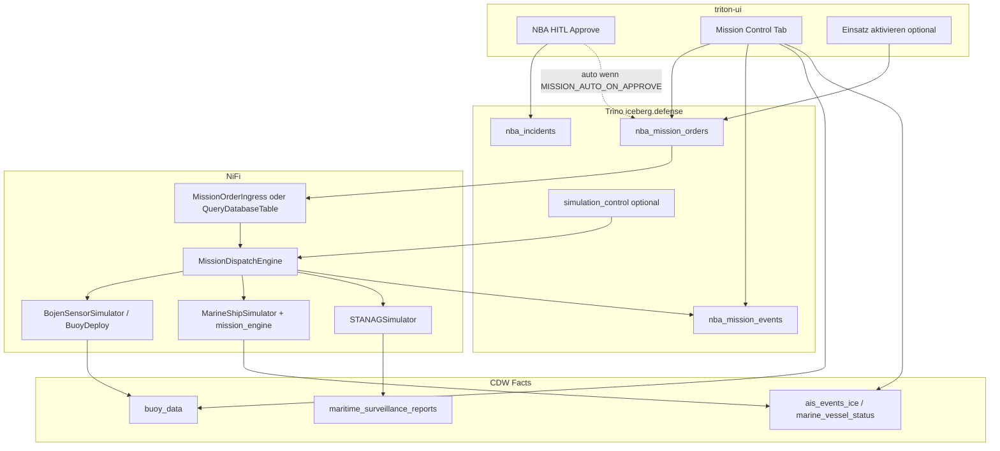
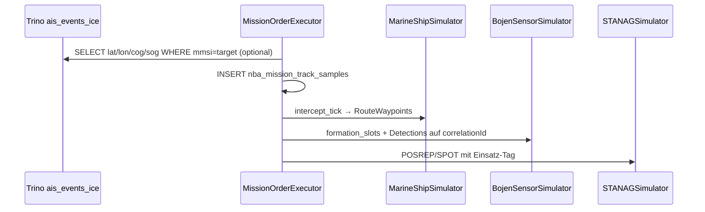
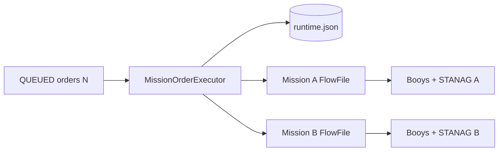

# Implementierungsplan: Mission Einsatz (Simulation) nach NBA-HITL-Freigabe

Stand: November 2026 · Repository: **Triton Baltic Sea Observer**  
Verwandt: [NBA UC2](../cai-workbench/next-best-action/IMPLEMENTIERUNGSPLAN.md) · [Simulation Control](./IMPLEMENTIERUNGSPLAN_SIM_CONTROL.md) · [Mission Planning SAP](./IMPLEMENTIERUNGSPLAN_MISSION_SAP.md) · [C2SIM](./IMPLEMENTIERUNGSPLAN_C2SIM_TRITON.md) · [UI Overview](../triton-ui/docs/UI_OVERVIEW.md) · [NiFi Simulatoren](../nifi-processors/upload/README.md)

## 1. Ziele und Abgrenzung

| Ziel | Beschreibung |
| :---- | :---- |
| **Geschlossener Pfad** | Nach Operator-Freigabe einer COA in **NBA HITL** wird ein **Einsatzauftrag** persistiert und die **NiFi-Simulation** startet eine Mission mit definiertem **Start**, **Ziel (Lat/Lon)** und **Ende** |
| **Zwei Einsatzprofile (Showcase)** | **(1)** Bojen-/Sensorcluster im Umkreis des Ziels · **(2)** Marineschiff-Einheit fährt zum Auftragsziel |
| **Beobachtbarkeit** | Ereignisse landen in bekannten **CDW-Tabellen** (`buoy_data`, `ais_events_ice` / `marine_vessel_status`, ggf. `maritime_surveillance_reports` / STANAG) und in neuen **Mission-Control-Tabellen** in **Trino/Iceberg** |
| **UI Mission Control** | Neuer Tab: Missionen listen, Status/Zeitleiste, Karte mit Bojen- oder Schiffspositionen |
| **Parallele Einsätze** | Mehrere `mission_id` gleichzeitig `ACTIVE` — getrennte Assets, getrennte CDW-Tags, NiFi-Fan-out pro Mission |

| Nicht in Scope (Phase 0–2) | Begründung |
| :---- | :---- |
| Reale Befehlserteilung an Einsatzmittel | Showcase bleibt **synthetisch** (NiFi) |
| SAP-Aktivierung als Auslöser | Folgt [Mission SAP](./IMPLEMENTIERUNGSPLAN_MISSION_SAP.md) **parallel** (Event nach HITL), nicht Ersatz für NiFi-Mission |
| C2SIM-Föderation als Pflicht | Optionaler Flag aus [C2SIM-Plan](./IMPLEMENTIERUNGSPLAN_C2SIM_TRITON.md) |
| Automatisches Approve → Mission ohne Bestätigung | Default: **zweistufig** (Approve COA, dann „Einsatz aktivieren“) — konfigurierbar auf **einstufig** |

## 2. Ist-Stand (relevante Bausteine)

| Baustein | Pfad / Verhalten | Lücke |
| :---- | :---- | :---- |
| HITL Approve | `triton-ui` → `POST /api/nba/incidents/:uuid/approve` → `nba_incidents.approved_*` | Kein **Auftrag** / keine Mission |
| Incident-Koordinaten | `nba_incidents.latitude`, `longitude`, `theatre`, `flow_uuid`, `approved_coa_id` | Ziel vorhanden, aber nicht an Simulation gebunden |
| COA → Fähigkeit | `coa_catalog.py` (A–D: SAR+K130, Fregatte, K130+LiDAR, passiv) | Kein Mapping **COA → mission_type** |
| Bojen-Simulation | `nifi-processors/upload/BojenSensorSimulator.py` → `buoy_data` | Zufällige Ostsee-Platzierung, **kein** Auftragsziel |
| Marine-Mission | `german_navy_mission_engine.py`, `MarineShipSimulator.py` | Patrol-Boxen, **kein** NBA-Ziel-Routing |
| STANAG | `STANAGSimulator.py`, `marine_fleet_registry.py` | Kein Trigger aus Mission-Auftrag |
| Simulation Control | Plan in [SIM_CONTROL](./IMPLEMENTIERUNGSPLAN_SIM_CONTROL.md) | `simulation_control` noch nicht Mission-spezifisch |
| UI Karten | `Lagebild`, `BuoyAnalyticsMap`, NBA-Layer | Kein **Mission Control** |

## 3. Zielarchitektur



**Prinzipien**

1. **Trino ist Auftragsspeicher** (Order of Record), nicht `/tmp` allein.
2. **Eine `mission_id` pro Einsatz**; **mehrere** Missionen dürfen parallel `ACTIVE` sein; `flow_uuid` → 1:n nur nach `COMPLETED` (siehe §4.8).
3. **Mission Target** = WGS84 aus Incident; optional `target_radius_km` und `coa_id` bestimmen **mission_type** und Parameter.
4. NiFi **pollt** neue Orders (`status = QUEUED`) oder empfängt **HTTP POST** (Ingress) — Produktion: Poll + Iceberg.

## 4. Fachliches Modell

### 4.1 Missionstypen

| `mission_type` | Simulation | CDW-Ziele | Typische COA |
| :---- | :---- | :---- | :---- |
| `BUOY_SENSOR_RING` | 3–8 Bojen im Ring um Target (`anchor_search_radius_km`) | `buoy_data` (+ Join in `buoy_near_harbours`) | A, C, D (passiv / LiDAR-Nähe) |
| `SURFACE_DISPATCH` | 1..n MMSI aus `marine_fleet_registry` Route → Target, Hold/ Patrouille | `marine_vessel_status`, `ais_events_ice`, STANAG POSITION | A, B, C |
| `COMBINED` | Bojen + K130 parallel | alle obigen | A (Multidomänen) |

### 4.2 Lebenszyklus (Status)

| `status` | Bedeutung | UI |
| :---- | :---- | :---- |
| `QUEUED` | Auftrag geschrieben, NiFi noch nicht gestartet | „Warte auf Simulation“ |
| `ACTIVE` | Simulation läuft, `started_at` gesetzt | Karte live |
| `ON_STATION` | Einheit/Bojenring am Ziel | Detail + ETA=0 |
| `COMPLETING` | Rücknahme / Ende-Phase | Countdown |
| `COMPLETED` | `ended_at` gesetzt, Erfolg | Archiv |
| `ABORTED` | Operator oder Timeout | Grund anzeigen |
| `FAILED` | Engine-Fehler | Log-Link |

**Start/Ende:** `started_at` beim ersten NiFi-Tick mit gültigem State; `ended_at` wenn `MissionTicksRemaining=0`, Hold abgeschlossen oder `planned_duration_min` erreicht.

### 4.3 Auftrag aus COA + Incident

Mapping (Version 1, in `mission_nato_playbook.json` — siehe §4.5):

| COA | Default `mission_type` | Parameter |
| :---- | :---- | :---- |
| A | `COMBINED` | `buoy_count=6`, `dispatch_units=1`, `unit_class=Korvetten` |
| B | `SURFACE_DISPATCH` | `dispatch_units=2`, `unit_class=Fregatten` |
| C | `BUOY_SENSOR_RING` + optional `SURFACE_DISPATCH` | `buoy_count=4`, `requires_alb_lidar=true` |
| D | `BUOY_SENSOR_RING` | `buoy_count=3`, `passive_only=true` |

Zielkoordinaten:

```text
target_latitude  := nba_incidents.latitude
target_longitude := nba_incidents.longitude
```

Fallback: `alert_payload` JSON `$.geometry` oder Decision Record §3 `incident_location`.

### 4.4 Dynamische Zielverfolgung (Target Track)

**Problem:** Viele Ostsee-Alerts sind **bewegliche Kontakte** (Dark Vessel, Referenz-MMSI, Sonar-Korrelation) — ein statischer Incident-Punkt reicht für realistische Anfahrt nicht.

| `target_mode` | Quelle | NiFi/CML-Verhalten |
| :---- | :---- | :---- |
| `STATIC_POINT` | `nba_incidents.latitude/longitude` | Einmalige Route / fester Bojenring |
| `VESSEL_MMSI` | `alert_payload.target_mmsi` + Trino `ais_events_ice` | **Jeder Tick:** letzte Position → neu `intercept_tick` / Formation |
| `CORRELATED_OBJECT` | `alert_payload.correlation_id` / Sonar-ID | Track über Bojen-`payload_object_correlationId` + Dead Reckon Fallback |

**Zeitfenster:** `track_duration_min` aus NATO-Playbook pro COA (z. B. A=240 min, D=360 min). Nach Ablauf: `COMPLETING` → `COMPLETED`.

**Implementierung:**

| Modul | Pfad | Aufgabe |
| :---- | :---- | :---- |
| Track-Engine | `nifi-processors/upload/mission_target_track.py` | Dead Reckon, `formation_slots`, `intercept_tick`, STANAG-Footer |
| Dispatch | `cai-workbench/next-best-action/src/mission_dispatch.py` | Order aus Incident + Playbook |
| Samples | `nba_mission_track_samples` | Zeitreihe für Mission-Control-Karte |

**Ablauf pro Simulator-Tick:**



**Anfahrt (Surface):** `approach` aus Playbook — `INTERCEPT` (COA A/C), `DELAYED_INTERCEPT` (B, größerer Standoff), `SHALLOW_INTERCEPT` (C, niedrige Fahrt). Geschwindigkeit `speed_cap_kn`; On-Station-Abstand `standoff_on_station_km`.

**Bojen:** Physische Positionen werden beim **Deploy** gesetzt; während **TRACK** ändern sich `payload_object_*` und `correlationId` zur **aktuellen Zielschätzung** (MDA-konform: verteilte Sensoren melden denselben Contact).

### 4.5 NATO-Playbook: Bojen-Deployment pro COA A–D

**Quelle:** [`cai-workbench/next-best-action/data/mission_nato_playbook.json`](../cai-workbench/next-best-action/data/mission_nato_playbook.json) — verknüpft mit [`rules_playbook.json`](../cai-workbench/next-best-action/data/rules_playbook.json) (`playbook_rule_ids`).

| COA | Formation | Bojen | Sensorprofil | Surface | STANAG-Profil |
| :---- | :---- | :---- | :---- | :---- | :---- |
| **A** | `LEADING_SEMICIRCLE` | 6 | Multidomain MAD + acoustic proxy | 1× K130, INTERCEPT 6 km | `watch_section` |
| **B** | `STANDOFF_RING` | 4 | EO-Cue MAD, großer Ring | 2× Fregatte, DELAYED 15 km | `routine_patrol` |
| **C** | `SHALLOW_TRAIL` | 5 | MAD trail + ALB-Korrelation | 1× K130, SHALLOW 4 km | `snap_exercise` |
| **D** | `PASSIVE_DENSE_RING` | 8 | Nur passive MAD (MC 362) | **keine** Einheit | `hq_pulse` |

`expand_buoy_roles(coa_id)` liefert Slots mit `deployment_role`, `payload_object_type`, STANAG-Flag pro Slot.

**NiFi `BojenSensorSimulator` Erweiterung (Phase 1b):**

- Modus `MISSION_PLAYBOOK`: liest `parameters_json.buoys` + live Target → `formation_slots()`
- FlowFile-Attribute: `mission.id`, `mission.buoy.role`, `mission.playbook.profile`
- Jeder Datensatz: `buoyid` = `MAD-{einsatz_short}-{seq}`, Spalten `mission_id`, `einsatz_id`, `deployment_role`, `playbook_sensor_profile` (DDL §5)

### 4.6 STANAG-Meldungen mit Einsatz-ID und Bojen-Sensor

**Anforderung:** Jede missionsbezogene Meldung ist in CDW filterbar und im Volltext nachvollziehbar.

| Feld | `maritime_surveillance_reports` | Inhalt |
| :---- | :---- | :---- |
| `mission_id` / `einsatz_id` | neu (DDL) | Gleicher UUID wie `nba_mission_orders` |
| `buoy_id` | neu | `MAD-MSN-…` bei SPOT/INTREP aus Bojen |
| `target_correlation_id` | neu | Sonar/MDA-Kette |
| `message_id` | bestehend | Präfix optional `NBA-MSN/` |
| `message_text` / `body` | bestehend + Footer | `// EINSATZ {mission_id} BUOY {buoy_id} CORR {correlation_id}` |

**Engine:** `stanag_message_engine.py` / `mission_target_track.tag_stanag_message_body()` — bei Traffic Profile `nba_mission` oder FlowFile-Attribut `mission.id`:

- `message_subject`: `NBA-MSN/{mission_id_short} — SPOT …`
- Footer in `message_text` (View `marine_messages` parst DTG unverändert)

**NiFi `STANAGSimulator.py`:** Properties `Mission ID`, `Buoy ID`, `Correlation ID` (optional aus upstream Mission-PG).

**Events:** `nba_mission_events.event_type = STANAG_SENT` mit `payload_json.message_id`, `buoy_id`.

### 4.7 Verknüpfung Playbook ↔ HITL

1. Operator wählt COA **A–D** in HITL (bereits `approved_coa_id`).
2. `build_mission_order(incident)` mergt Playbook + `alert_payload` (MMSI, COG, SOG).
3. Decision Record **§11_mission_execution** enthält: `playbook_version`, `target_mode`, `track_duration_min`, `buoy_roles[]`, `stanag_profile`.
4. Bei Widerspruch Playbook vs. `rules_playbook` (z. B. FLASH + COA B schwer): UI-Warnung, kein Auto-Deploy ohne Override.

### 4.8 Parallele Missionen (Multi-Mission)

**Anforderung:** Mehrere Incidents können **gleichzeitig** einen laufenden Einsatz haben (verschiedene `flow_uuid` / `mission_id`).

| Ebene | Mechanismus |
| :---- | :---- |
| **Trino** | Viele Zeilen `nba_mission_orders` mit `status IN (ACTIVE, ON_STATION)`; Zuordnung `nba_mission_asset_allocations` (MMSI/Boje) |
| **CML/UI** | `validate_order_against_active()` vor `INSERT` — Caps aus `mission_nato_playbook.json` → `parallelism` |
| **NiFi** | `mission_parallel.py` + `MissionOrderExecutor.py`: Runtime-Map `missions:{id}`; **ein Downstream-FlowFile pro Mission** |
| **Marine** | Pro Mission eigene MMSI aus `allocate_surface_units` — kein doppeltes Booking |
| **Bojen** | IDs `MAD-{mission_short}-{seq}` — **kein** globaler `buoy_counter` im Missionsmodus |
| **STANAG** | `mission_id` / `buoy_id` Pflicht auf missionsbezogenen Meldungen |

**Caps (Default Showcase):**

| Parameter | Wert |
| :---- | :---- |
| `max_active_missions` | 8 |
| `max_surface_units_total` | 4 (geteilte Marine-Flotte) |
| `max_buoy_slots_total` | 32 |
| `allow_same_flow_uuid_parallel` | false (Re-Deploy erst nach `COMPLETED`) |

**NiFi-Audit:** [`nifi-processors/docs/MISSION_PARALLEL_NIFI.md`](../nifi-processors/docs/MISSION_PARALLEL_NIFI.md)

**Lücke `nba_incidents.active_mission_id`:** Ein einzelnes Feld reicht nicht — UI listet aktive Missionen via `SELECT … FROM nba_mission_orders WHERE flow_uuid=? AND status NOT IN (…)` oder später `active_mission_ids` JSON.

**Multi-Node:** `/tmp/triton_mission_runtime.json` ist **pro Pod** — `MissionOrderExecutor` nur auf **einer** NiFi-Rolle oder Bindings ausschließlich in Trino pflegen.



## 5. Trino-Schema (Neu)

**Dateien:** `cdw-analyse/sql/nba_schema_mission_tracking.sql` (inkl. Track-Samples + STANAG/Buoy-Tags)  
**Anwenden:** `python3 run_trino_ddl.py sql/nba_schema_mission_tracking.sql --continue`

### 5.1 `nba_mission_orders` (Aufträge)

| Spalte | Typ | Beschreibung |
| :---- | :---- | :---- |
| `mission_id` | VARCHAR | UUID, PK |
| `flow_uuid` | VARCHAR | FK logisch → `nba_incidents` |
| `approved_coa_id` | VARCHAR | Snapshot zum Startzeitpunkt |
| `mission_type` | VARCHAR | siehe §4.1 |
| `status` | VARCHAR | siehe §4.2 |
| `target_latitude` | DOUBLE | WGS84 |
| `target_longitude` | DOUBLE | WGS84 |
| `target_radius_km` | DOUBLE | Default 15 |
| `parameters_json` | VARCHAR | Bojenanzahl, MMSI-Liste, Dauer, … |
| `planned_start` | TIMESTAMP(6) | optional geplant |
| `started_at` | TIMESTAMP(6) | NULL bis ACTIVE |
| `ended_at` | TIMESTAMP(6) | NULL bis Ende |
| `issued_by` | VARCHAR | Operator / `nba-auto` |
| `issued_at` | TIMESTAMP(6) | Audit |
| `updated_at` | TIMESTAMP(6) | letzte State-Änderung |
| `notes` | VARCHAR | optional |

### 5.2 `nba_mission_events` (Audit + UI-Zeitleiste)

| Spalte | Typ | Beschreibung |
| :---- | :---- | :---- |
| `event_id` | VARCHAR | UUID |
| `mission_id` | VARCHAR | |
| `event_ts` | TIMESTAMP(6) | |
| `event_type` | VARCHAR | `ORDER_CREATED`, `SIM_STARTED`, `UNIT_DISPATCHED`, `ON_STATION`, `STANAG_SENT`, `BUOY_DEPLOYED`, `COMPLETED`, … |
| `payload_json` | VARCHAR | MMSI, buoyid, message_id, lat/lon, … |
| `source` | VARCHAR | `nifi`, `ui`, `nba` |

### 5.3 Erweiterung `nba_incidents` (optional, denormalisiert)

```sql
ALTER TABLE nba_incidents ADD COLUMN IF NOT EXISTS active_mission_id varchar;
ALTER TABLE nba_incidents ADD COLUMN IF NOT EXISTS mission_status varchar;
```

Ermöglicht NBA-Liste: „Approved + Mission läuft“ ohne Join.

### 5.4 Bezug `simulation_control`

Für `SURFACE_DISPATCH` zusätzlich Zeile in `simulation_control` (Phase 1 SIM_CONTROL):

- `command`: `RUN_STANDARD` → Custom **`MISSION_GOTO`** (neu in `sim_command.py`) mit `parameters_json.target_lat/lon`, `mmsi_allowlist`
- `issued_by`: `mission:{mission_id}`

## 6. NiFi — neuer Prozessor und Flow

### 6.1 `MissionOrderExecutor.py` (Python Processor)

| Eigenschaft | Default | Beschreibung |
| :---- | :---- | :---- |
| Trino JDBC | Parameter Context | Lesen/Schreiben Orders |
| Poll Interval | 30 s | `SELECT … WHERE status = 'QUEUED'` |
| Max Active Missions | 8 (Playbook) | Parallele NBA-Einsätze; hartes Cap |
| State File | `/tmp/triton_mission_runtime.json` | `missions:{mission_id}` Map |

**Ablauf pro Order:**

1. `UPDATE status='ACTIVE', started_at=now()` + Event `SIM_STARTED`
2. Branch auf `mission_type`:
   - **BUOY:** FlowFiles an Untergruppe **Buoy Deploy** (siehe §6.2)
   - **SURFACE:** Attribute `mission.target.lat/lon`, `mission.mmsi` an **MarineShipSimulator**-Pfad
3. Periodisch: Fortschritt prüfen → `ON_STATION` → Events
4. Ende: `COMPLETED`, `ended_at`, ggf. `simulation_control` zurück auf `RUN_STANDARD`

**Wiederverwendung:** `sim_command.py` (SIM_CONTROL), `baltic_ship_routing.build_sea_route`, `baltic_water_placement`, `marine_fleet_registry`.

### 6.2 Erweiterung `BojenSensorSimulator.py`

Neue Processor-Property **„Deployment Mode“**: `RANDOM_HARBORS` (heute) | `MISSION_RING`.

Bei `MISSION_RING` aus FlowFile-Attributen:

- `mission.target.lat`, `mission.target.lon`, `mission.buoy_count`, `mission.mission_id`
- Platzierung: `sample_water_near_harbor` **ersetzen** durch `sample_water_on_ring(center, radius_km, n)` (neu in `baltic_water_placement.py`)

Jede Boje: `buoyid` Präfix `MSN-{mission_id_short}-{seq}` für UI-Filter.

### 6.3 Erweiterung Marine / Mission Engine

In `german_navy_mission_engine.py` (oder dünnem `mission_goto.py`):

- Funktion `assign_goto_mission(ships, target_lat, target_lon, ticks_remaining, mission_id)`
- Setzt `RouteWaypoints`, `MissionTicksRemaining`, `simPhase=underway`, `activeMissionId`

**STANAG:** Bei `ON_STATION` optional Burst in `STANAGSimulator` (Property `mission_id` / `exercise_profile=nba_dispatch`).

### 6.4 NiFi Process Group „Mission Execution“

Empfohlener Flow (aus `proj_triton` ableiten):

```text
QueryDatabaseTable / MissionOrderExecutor
  → RouteOnAttribute (mission_type)
    → Buoy Deploy → PutDatabaseRecord (buoy_data)
    → Marine Patch (UpdateAttribute state file / InvokeHTTP internal)
    → LogMissionEvent (PutDatabaseRecord nba_mission_events)
```

Keine Änderung an Timer der bestehenden Simulatoren — nur **State/Route** durch Mission Engine.

## 7. UI — Tab „Mission Control“

**Route:** `#mission` · **Dateien:** `triton-ui/src/pages/MissionControl.tsx`, Server `triton-ui/server/mission.js`

### 7.1 Navigation

- `App.tsx`: Zone `mission`, Label **„Mission Control“**
- Nach HITL-Approve: Hinweis + Link „Einsatz planen“ (wenn `MISSION_UI_TWO_STEP=true`)

### 7.2 API (Express)

| Methode | Pfad | Aktion |
| :---- | :---- | :---- |
| GET | `/api/missions` | Liste aus `nba_mission_orders` (letzte 50) |
| GET | `/api/missions/:missionId` | Order + Events |
| POST | `/api/missions/activate` | Body: `{ flowUuid, coaId?, missionType?, issuedBy }` → INSERT Order |
| POST | `/api/missions/:missionId/abort` | `status=ABORTED` |
| GET | `/api/missions/:missionId/live-geo` | Trino: Bojen `buoy_data` oder Marine `marine_vessel_status` gefiltert auf `mission_id` / buoyid-Präfix |

### 7.3 Oberfläche

| Bereich | Inhalt |
| :---- | :---- |
| Tabelle | Mission-ID, Incident-Theatre, COA, Typ, Status, Start, Ende, Dauer |
| Detail | Zeitleiste aus `nba_mission_events` |
| Karte | Leaflet (wie `BuoyAnalyticsMap`): Target-Marker, Ring, Live-Bojen/Schiff |
| Aktion | „Einsatz aktivieren“ (wenn Incident `APPROVED` und kein `active_mission_id`) |

Sample-Modus: `triton-ui/server/data/mission-control-sample.json` analog NBA.

### 7.4 HITL-Integration (zwei Modi)

| Modus | Verhalten |
| :---- | :---- |
| **A — Zwei Schritte** | Approve wie heute; Operator wechselt zu Mission Control und aktiviert |
| **B — Auto** | `approveNbaIncident` ruft nach erfolgreichem UPDATE `createMissionOrder(flowUuid)` (Feature-Flag `MISSION_AUTO_ON_APPROVE=1`) |

Empfehlung Showcase: **A** (Audit klarer); Demo-Video: **B**.

## 8. Ereignisfluss in CDW-Tabellen

| Missionstyp | Tabelle | Inhalt |
| :---- | :---- | :---- |
| Bojen | `iceberg.defense.buoy_data` | MAD/LiDAR-ähnliche Sensoren, Position im Ring |
| Schiff | `marine_vessel_status`, `ais_events_ice` | Track zum Ziel, `sog`/`cog` |
| STANAG | `maritime_surveillance_reports` / View `marine_messages` | OPERATION / POSITION bezogen auf Einheit |
| Mission Meta | `nba_mission_events` | alles Operative für UI |
| Lagebild | bestehende Views | optional Layer „Active Missions“ (Phase 3) |

**Hinweis:** Im Sprachgebrauch „AES“ im Showcase meist **AIS-Ereignisse** (`ais_events_ice`); akustische Pipelines (DAS) bleiben [eigenes UI-Kapitel](../docs/DAS_NIFI_AND_UI_FORMAT.md).

## 9. CML / NBA-Pipeline

| Aufgabe | Ort |
| :---- | :---- |
| COA + Playbook + Target | `cai-workbench/next-best-action/src/mission_dispatch.py` |
| Nach Approve (optional) | `hitl.py` / Webhook in `triton-ui/server/nba.js` |
| Decision Record §11 | `decision_record.py`: `11_mission_execution` mit `mission_id`, geplantem Typ |
| Tests | `tests/test_mission_dispatch.py`, `tests/test_greifswald_scenario.py` erweitern |

## 10. Phasenplan

### Phase 0 — Datenmodell + manueller Pfad (1 Sprint)

| # | Aufgabe | Akzeptanz |
| :-- | :---- | :---- |
| 0.1 | DDL `nba_mission_orders`, `nba_mission_events` | Trino `DESCRIBE` ok |
| 0.2 | SQL-Beispiel `scripts/insert_demo_mission.sql` | Mission QUEUED sichtbar |
| 0.3 | UI Mission Control read-only (Liste + Karte Sample) | `#mission` lädt |
| 0.4 | Doku-Verlinkung README | — |

### Phase 1 — UI-Auslösung + Playbook-Bojen + Track-Samples

| # | Aufgabe | Akzeptanz |
| :-- | :---- | :---- |
| 1.1 | `POST /api/missions/activate` → `build_mission_order` | COA A–D korrektes `parameters_json` |
| 1.2 | `BojenSensorSimulator` `MISSION_PLAYBOOK` | Formation je COA; `mission_id` auf `buoy_data` |
| 1.3 | `MissionOrderExecutor` MVP + `mission_target_track` | `nba_mission_track_samples` bei MMSI-Track |
| 1.4 | Events `BUOY_DEPLOYED`, `TARGET_REFRESH` | UI-Zeitleiste |
| 1.5 | Unit `test_mission_dispatch`, `test_mission_target_track` | grün |

### Phase 2 — Marineschiff + STANAG-Tags

| # | Aufgabe | Akzeptanz |
| :-- | :---- | :---- |
| 2.1 | `intercept_tick` in Marine-State | Schiff folgt beweglichem Target auf Wasser |
| 2.2 | STANAG Footer + Spalten `mission_id`, `buoy_id` | Filter in Trino auf Einsatz |
| 2.3 | UI Live-Geo: Target-Trail + Schiff + Bojen | Mission Control Karte |
| 2.4 | COA A `COMBINED` + `track_duration_min` | Ende nach Playbook-Zeit |

### Phase 3 — Härtung & Integration

| # | Aufgabe |
| :-- | :---- |
| 3.1 | Auto-Activate Flag, Abort, `effective_until` |
| 3.2 | Lagebild-Layer „Active Missions“ |
| 3.3 | `simulation_control` Integration (SIM_CONTROL Phase 1) |
| 3.4 | CloudEvent-Stub `triton.nba.mission.started` für SAP/C2SIM |
| 3.5 | E2E-Test: Approve → Activate → Trino buoy + marine within 10 min |

## 11. Tests

| Ebene | Ort | Fokus |
| :---- | :---- | :---- |
| Unit | `nifi-processors/tests/test_mission_goto.py` | Route endet in Target-Radius |
| Unit | `test_fishing_boat_mission_sim.py` Pattern | State JSON `activeMissionId` |
| Unit | `mission_dispatch.py` | COA → type/parameters |
| Integration | Ohne NiFi: Executor-State + mock Trino | Status-Übergänge |
| UI | Playwright/manual | Activate, Karte, Abort |
| Regression | `RUN_STANDARD` ohne Mission | bestehende Sim-Ticks unverändert |

## 12. Risiken und Mitigation

| Risiko | Mitigation |
| :---- | :---- |
| Ziel auf Land | `snap_to_baltic_water` / `is_baltic_water` vor Persistenz |
| Mehrfach-Aktivierung | Unique partial index logisch: ein `ACTIVE` pro `flow_uuid` |
| NiFi ohne Trino | Orders QUEUED bleiben; UI zeigt Warnung |
| Bojen id-Kollision | Präfix `MSN-*` |
| Schiff nicht auf Wasser Route | `build_sea_route` wie Marine-Simulator |
| Demo-Last | Playbook-Caps + `validate_order_against_active` |
| MMSI-Doppelbuchung | `nba_mission_asset_allocations` + `allocated_mmsis()` |
| Multi-Node `/tmp` | Executor auf einer Rolle oder Trino-only bindings |

## 13. Environment

| Variable | Wo | Zweck |
| :---- | :---- | :---- |
| `MISSION_AUTO_ON_APPROVE` | `triton-ui` | 0/1 |
| `MISSION_UI_TWO_STEP` | `triton-ui` | Default 1 |
| `MISSION_DEFAULT_RADIUS_KM` | NiFi / CML | 15 |
| `TRINO_*` | NiFi Executor | JDBC |

Einträge in `.env.default` (nur Namen).

## 14. Akzeptanz gesamt (Release Phase 1–2)

1. Operator genehmigt COA in HITL, aktiviert Einsatz in Mission Control.
2. Innerhalb weniger NiFi-Zyklen: `status=ACTIVE`, `started_at` gesetzt.
3. Je nach Typ: Bojen im Ring **oder** Marine-Track zum Incident-Punkt in CDW sichtbar.
4. Mission Control zeigt Zeitleiste und Karte konsistent mit Trino.
5. `ended_at` und `COMPLETED` nach definierter Dauer; Audit in `nba_mission_events`.
6. Bestehende Showcase-Flows ohne PG-Umbau deploybar (Processor-Update + DDL).

## 15. Nächste Schritte (Repository)

1. Branch `cursor/mission-einsatz-phase0-b3d7`: DDL + UI-Skeleton + `mission_dispatch.py` Stub.
2. `run_trino_ddl.py` um `nba_schema_mission_execution.sql` erweitern.
3. PR mit Verweisen in `README.md`, `triton-ui/docs/UI_OVERVIEW.md`, `cai-workbench/next-best-action/README.md`.

---

*Unter-Docs bei Bedarf:* `docs/MISSION_CONTROL_UI.md` (Wireframes), `nifi-processors/docs/MISSION_EXECUTOR.md` (Betrieb).