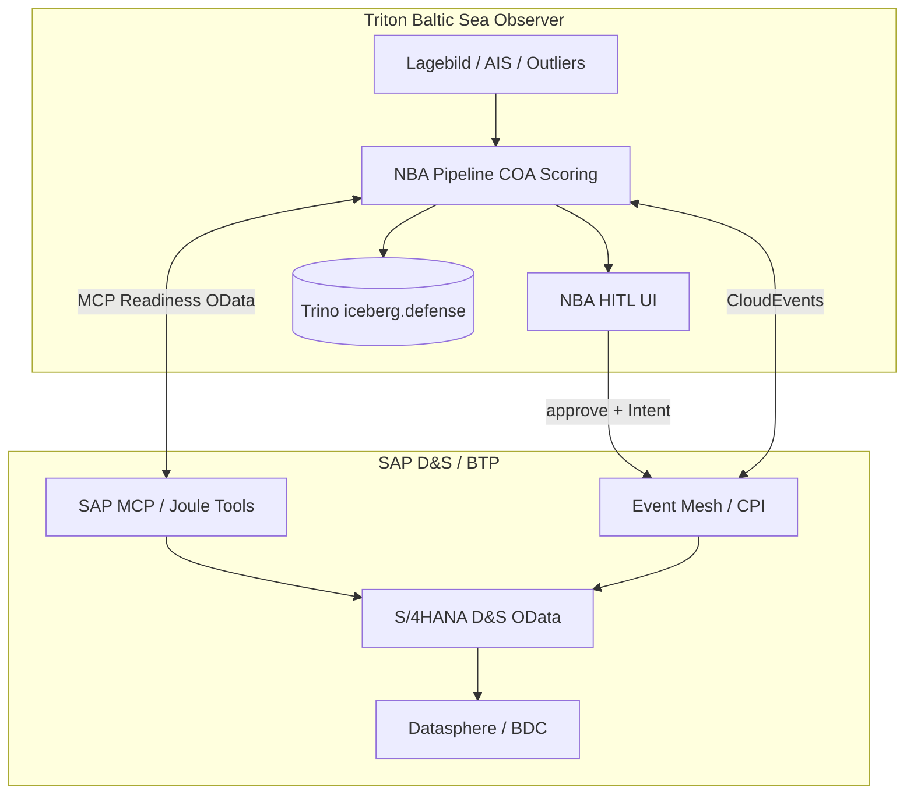
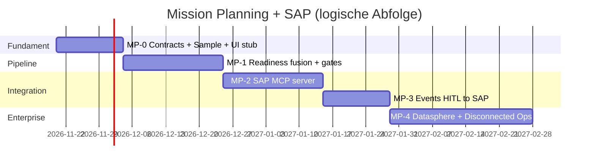

# Implementierungsplan: Operative Einsatzplanung (Mission Planning) mit SAP S/4HANA Defense & Security

Stand: November 2026 · Repository: **Triton Baltic Sea Observer**  
Verwandte Pläne: [NBA UC2](../cai-workbench/next-best-action/IMPLEMENTIERUNGSPLAN.md) · [NATO UI](../triton-ui/docs/UI_OVERVIEW.md) · [MCP Phase 8](../cai-workbench/next-best-action/docs/MCP_CURSOR_SETUP.md)

## 1. Executive Summary

**Mission Planning (MP)** erweitert den bestehenden **Sensor-to-COA**-Pfad (NBA) um die **logistische und kräftebezogene Realität** aus SAP S/4HANA Defense & Security (D&S). Triton liefert taktisches Lagebild, Anomalien und bewertete Handlungsoptionen (COAs); SAP liefert Force Elements, METL/Capability Codes, Readiness, Munition/Wartung und Einsatzstrukturen.

Das Zielbild ist ein **geschlossener Zyklus Intent → Freigabe → Ausführung**: Anomalie → COA-Matrix → SAP-gestützte Machbarkeitsprüfung → HITL-Freigabe → Aktivierung in SAP + taktische Koordinaten im C2/Lagebild — mit durchgängigem Audit (PROV, Decision Record, Trino).



## 2. Fachliche Rolle von SAP (Referenzmodell)

| SAP-D&S-Domäne | Bedeutung für Ostsee-Einsätze | Triton-Entsprechung (heute) | Lücke |
| :---- | :---- | :---- | :---- |
| Force Elements / TOE | Einsatzverbände, Rotationen, Provider-Zuordnung | `german_navy_mission_engine`, `marine_fleet_registry` (NiFi) | Kein formaler Force-Element-Schlüssel |
| METL / Capability Codes | Filter „wer kann Minenabwehr / SAR / K130 innerhalb T+30?“ | COA-Katalog A–D mit impliziten Fähigkeiten in `coa_catalog.py` | Kein SAP-Readiness-Abgleich |
| Readiness (Infotype 1951) | Materiell/personell/ausbildungsseitig einsatzbereit | Proxy über Flotten-/Schiffsdaten in `ships` | Staging-Tabelle fehlt |
| Status Board / Munition / PM | Effektoren wirklich verfügbar? | `sensor_gates`, `env_gates` (Wetter/ISR) | Kein ERP-Status |
| Disconnected Operations | DDIL an Bord, spätere Sync | Offline-Demo `TRITON_FORCE_SAMPLE_DATA` | Kein SAP-Replikat |
| AATP / Materialreservierung | Nachschub vor Aktivierung | — | Neu |

**Prinzip:** SAP **schreibt** keine COAs; es **constraintiert** und **materialisiert** eine menschlich freigegebene Option.

## 3. Bezug zum Triton-Code (Ist-Architektur)

| Stufe | Komponente | Pfad |
| :---- | :---- | :---- |
| Erkennung | Alert SQL, Lagebild-Kandidaten | `cdw-analyse/sql/alerts/`, `alert_detector.py` |
| Snapshot-Bündel | Iceberg `FOR VERSION AS OF` | `snapshot_bundle.py`, `nba_incident_snapshots` |
| COA + Simulation | Scoring, Red/Blue | `scoring.py`, `sim_adapter.py`, `red_blue_gameplay.py` |
| Decision Record §1–§9 | Audit + What-if | `decision_record.py`, HITL `NbaDecisionRecorder.tsx` |
| Persistenz | Incidents, COA matrix, HITL | `persistence.py`, DDL `cdw-analyse/sql/nba_schema_*.sql` |
| Freigabe | Human-in-the-Loop | `triton-ui` `POST /api/nba/incidents/:uuid/approve` |
| Governance | PROV / Bundle | `governance_export.py` (Phase 7) |
| Agenten-Schnittstelle | MCP Iceberg, Semantica | `mcp_snapshot_bundle.py`, `docs/MCP_CURSOR_SETUP.md` |

**MP-Einfügepunkt:** Nach `rank_coas` / vor oder während `finalize_hitl_artifacts` — neuer Schritt **`readiness_fusion`** (SAP + Trino-Staging).

## 4. Integrationsmuster (Zielarchitektur)

### 4.1 Agentic: MCP als „USB-C“ zwischen ERP und NBA

| Richtung | Mechanismus | Inhalt |
| :---- | :---- | :---- |
| Triton → SAP | **SAP MCP Server** (BTP) oder dedizierter `sap-ds-mcp` im Repo | Tools: `list_force_elements`, `query_readiness`, `get_capability_match`, `preview_material_atp` |
| SAP/Joule → Triton | Destinations + externer **Triton MCP** (Erweiterung von Phase 8) | Tools: `get_incident`, `get_coa_matrix`, `get_lagebild_summary` (keine PII-Roh-AIS im LLM ohne Gate) |
| Multi-Agent | **A2A** neben MCP | Orchestrierung Planungsstab-Agent ↔ Logistik-Agent |

**Clean Core:** Nur freigegebene OData-APIs (SAP Business Accelerator Hub) und Datasphere-Views; keine Custom-Tabellen in S/4-Kern.

### 4.2 Ereignisgesteuert (zeitkritisch)

| Event (CloudEvents) | Quelle | Konsument | Wirkung |
| :---- | :---- | :---- | :---- |
| `sap.readiness.degraded` | Status Board Alert | NBA / Lagebild | COA-Gates: Einheit aus Matrix streichen |
| `sap.munition.shortage` | Explosives Management | Scoring | Eskalations-COA down-rank |
| `triton.nba.incident.escalated` | `sitrep_bridge.py` | CPI → SAP | Voranlage Operational Force Element |
| `triton.nba.coa.approved` | HITL approve | CPI → SAP | Aktivierung, Reservierung, Wartungsauftrag |

Transport: **SAP Integration Suite (CPI)** + **Advanced Event Mesh**; im Showcase zunächst **HTTP-Webhook-Stubs** in `triton-ui/server/`.

### 4.3 Semantisch: Datasphere / Business Data Cloud

| Objekt | Herkunft | Nutzen |
| :---- | :---- | :---- |
| `dim_force_element` | SAP | Join zu `ships` / nationaler Flotten-ID |
| `fact_readiness_snapshot` | SAP (täglich + Event-Delta) | Trino-Iceberg-Staging `sap_readiness_staging` |
| `fact_incident_nba` | Triton | Rückspiegelung für SAP Analytics |
| Maritime Ontologie | `baltic_ontology.json` + Semantica | Gemeinsame Begriffe (Theatre, COA, Unit) |

## 5. Showcase-Workflow (Sensor-to-Plan)

| Schritt | Ausführend | Aktion (Ostsee-Beispiel) | Repo-Hook |
| :---- | :---- | :---- | :---- |
| 1 | Triton | AIS-Blackout nahe Pipeline, Eskalation `sitrep_escalation` | `pipeline_blackout_top1.sql`, Greifswald-Demo |
| 2 | Planungs-Agent | MCP: Capability „Seeüberwachung / Minenabwehr“, Readiness ≤ 30 Tage | **MP-1** `sap_readiness.py` |
| 3 | KI / Stab | Fusion Lage + SAP-Restriktionen → 2 COAs mit ETA, Nachschub | Decision Record **§10_mission_planning** |
| 4 | Kommandeur | HITL wählt COA, Intent bestätigt | bestehendes `approve` |
| 5 | SAP + C2 | Force Element, Rotation, Versorgung; Lagebild Tracks | Events **MP-3**; optional SitaWare/CoT später |

## 6. Phasenplan (Implementierung im Repository)

### MP-0 — Dokumentation, Contracts, Demo-Fixtures (1 Sprint) — **umgesetzt**

**Ziel:** Kein SAP-System nötig; nachvollziehbare Schnittstellen.

| Lieferobjekt | Ort | Details |
| :---- | :---- | :---- |
| OData/MCP Contract (YAML) | `docs/sap-ds-odata-contract.yaml` | Read-only Endpunkte + Feld-Mapping |
| Sample Readiness JSON | `cai-workbench/next-best-action/data/sap_readiness_sample.json` | 3–5 Einheiten, Capability-Codes, Readiness-Ampel |
| Trino DDL (optional) | `cdw-analyse/sql/nba_schema_mp0_readiness.sql` | `sap_readiness_staging` (Iceberg) |
| Env-Template | `.env.default` | `SAP_DS_*`, `NBA_SAP_READINESS_MODE=sample\|odata\|off` |
| UI-Stub | HITL Panel **„Einsatzbereitschaft (SAP)“** | Tabelle aus Sample oder API |

**Akzeptanz:** Pipeline läuft mit `NBA_SAP_READINESS_MODE=sample`; COA-Gate `sap_readiness_ok` in `scoring.py` dokumentiert.

### MP-1 — Readiness-Fusion im NBA-Pipeline (2 Sprints) — **umgesetzt**

| Aufgabe | Modul | Verhalten |
| :---- | :---- | :---- |
| Client | `src/sap_readiness.py` | OData oder Staging-Trino; Timeout, Cache pro `flow_uuid` |
| Gate | `env_gates.py` / `scoring.py` | COAs mit nicht verfügbarer Einheit: `gate_failed: sap_readiness` |
| Audit | `pipeline._write_artifacts` | `sap_readiness_audit` in `audit.json` |
| Decision Record | `decision_record.py` | Neuer Abschnitt `10_mission_readiness` |
| Tests | `tests/test_sap_readiness_gates.py` | Sample-Fixture, keine Live-SAP |

### MP-2 — SAP MCP Server (BTP oder lokal) (2–3 Sprints)

| Aufgabe | Details |
| :---- | :---- |
| Server | `integrations/sap-mcp/` — Python FastMCP, ruft OData mit OAuth2 Client Credentials |
| Cursor | Eintrag in `.cursor/mcp.json.example` neben Iceberg/Semantica |
| CML | JDBC/OData-Fallback wenn MCP nicht importierbar (Analogie `mcp_snapshot_bundle.py`) |
| Tool-Liste | `query_readiness_by_capability`, `get_force_element`, `list_rotations_in_window` |

**Sicherheit:** Keine Schreib-Tools im Showcase-MCP; Schreiben nur über explizite CPI-Flows nach HITL.

### MP-3 — Event-Brücke HITL → SAP (2 Sprints)

| Aufgabe | Ort |
| :---- | :---- |
| Outbound | `src/sap_intent_export.py` — Payload aus `approved_coa_id` + Decision Record |
| API | `POST /api/nba/incidents/:uuid/mission-intent` (optional, nur nach approve) |
| Inbound Webhook | `server/sap-events.js` — normalisiert CloudEvents → Trino `sap_event_log` |
| Re-Scoring Job | CML: bei `readiness.degraded` Incidents `open` neu bewerten |

### MP-4 — Datasphere-Sync & Disconnected Operations (langfristig)

| Aufgabe | Details |
| :---- | :---- |
| Batch | CPI: SAP → S3/ADLS → Trino `sap_readiness_staging` |
| Onboard | Mapping zu SAP Disconnected Operations Replikat (Schiffe als Provider) |
| Federated | FMN / domänenübergreifend — nur Architekturnotiz, keine UC-Implementierung im Repo |

## 7. Datenmodell (Erweiterung Decision Record)

Vorgeschlagener JSON-Abschnitt (ergänzt §1–§9):

```json
{
  "10_mission_readiness": {
    "source": "sap_sample | sap_odata | trino_staging",
    "queried_at": "2026-11-20T08:30:00Z",
    "capability_filter": ["SEA_SURVEILLANCE", "MCM"],
    "units": [
      {
        "force_element_id": "DE-M-123",
        "name": "FGS Bayern",
        "readiness_code": "R1",
        "capability_match": true,
        "rotation_conflict": false,
        "fuel_days_remaining": 12,
        "munition_gate": "ok"
      }
    ],
    "coa_impact": {
      "A": { "executable": true, "blockers": [] },
      "B": { "executable": false, "blockers": ["sap_readiness:FGS X not R1"] }
    }
  }
}
```

Persistenz: Feld `mission_readiness_json` in `nba_incidents` (DDL Phase MP-1 analog `decision_record_json`).

## 8. Sicherheit, Governance, Souveränität

| Vorgabe | Umsetzung in Triton |
| :---- | :---- |
| Kein Agent-Write auf SAP ohne Mensch | MCP read-only; `approve` bleibt einzige Freigabe; CPI mit 4-Augen optional |
| SAP-Berechtigungen nicht umgehen | Service-User mit minimalen OData-Rollen; kein PII in Agent-Prompts |
| Prompt Injection / Datenabfluss | Phase 7 Guardrails; taktische Rohdaten nur strukturiert in Decision Record |
| Audit | `governance_bundle.json` + `sap_readiness_audit` + Event-IDs |
| Souveränität | SAP Sovereign Cloud / On-Prem; Trino/CDW national; keine US-SaaS-Pflicht im Plan |

## 9. Konfiguration (Env)

| Variable | Bedeutung |
| :---- | :---- |
| `NBA_SAP_READINESS_MODE` | `off` \| `sample` \| `odata` \| `trino` |
| `SAP_DS_BASE_URL` | OData-Basis (BTP Destination) |
| `SAP_DS_CLIENT_ID` / `SECRET` | Nur CML-Secrets, nicht Git |
| `NBA_SAP_CAPABILITY_MAP` | JSON-Pfad: COA-ID → SAP Capability Codes |
| `SAP_CPI_MISSION_WEBHOOK_URL` | Outbound nach HITL (MP-3) |

Siehe auch [`.env.default`](../.env.default) nach MP-0-Merge.

## 10. Abhängigkeiten und Reihenfolge



**Parallele Arbeit möglich:** MP-0 UI-Stub unabhängig von SAP-Landschaft; MP-2 parallel zu MP-1 wenn Contract stabil.

## 11. Erfolgskriterien (Showcase mit SAP-Partner)

1. Demo-Incident (Greifswald oder Live-Blackout): mindestens eine COA wird durch SAP-Readiness **ausgeschlossen**, eine **bestätigt**.
2. HITL zeigt §10 mit nachvollziehbarer Einheitenliste und Audit-Zeitstempel.
3. Nach Approve: simulierter CPI-Call (Mock 202) mit Payload-Schema aus `sap_intent_export.py`.
4. Dokumentierte Latenz: Readiness-OData &lt; 2 s P95 im Showcase-Netz (analog [API-Latenz-Messung](../triton-ui/docs/API_LATENCY.md) falls vorhanden).

## 12. Risiken

| Risiko | Mitigation |
| :---- | :---- |
| SAP-OData nicht in CDW erreichbar | Staging-Sync + `trino`-Modus |
| ID-Mapping Schiff ↔ Force Element | `dim_force_element` + manuelle Mapping-Tabelle |
| LLM halluziniert Verfügbarkeit | Gates nur aus strukturierten SAP-Feldern, nicht aus LLM-Text |
| Scope Creep (volles ERP im Repo) | Strikte MP-Phasen; Schreiben nur CPI |

## 13. Referenzen

- NBA UC2: [`cai-workbench/next-best-action/IMPLEMENTIERUNGSPLAN.md`](../cai-workbench/next-best-action/IMPLEMENTIERUNGSPLAN.md)
- UI NBA HITL: [`triton-ui/docs/UI_OVERVIEW.md`](../triton-ui/docs/UI_OVERVIEW.md)
- MCP: [`cai-workbench/next-best-action/docs/MCP_CURSOR_SETUP.md`](../cai-workbench/next-best-action/docs/MCP_CURSOR_SETUP.md)
- SAP S/4HANA D&S / BTP: Product Help (Force Elements, Readiness, Display Status Board, Disconnected Operations) — konkrete OData-Namen im Accelerator Hub beim MP-2-Start festlegen.