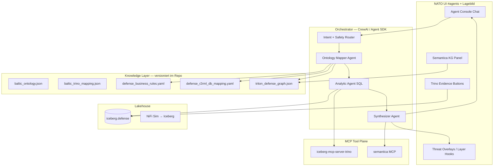

# Implementierungsplan: Ontology-Driven Agentic AI („Talk to your Data“)

Stand: November 2026 · Repository: **Triton Baltic Sea Observer**  
Verwandte Artefakte: [`AGENT_SEMANTICA_KG.md`](./AGENT_SEMANTICA_KG.md) · [`baltic_ontology.json`](../cai-workbench/next-best-action/data/baltic_ontology.json) · [`baltic_trino_mapping.json`](../cai-workbench/next-best-action/data/baltic_trino_mapping.json) · [`UI_OVERVIEW.md`](../triton-ui/docs/UI_OVERVIEW.md) · NBA Phase 8 MCP/Semantica · CML `workflow_data/config/*`

---

## 1. Executive Summary

**Ziel:** Natürlichsprachliche Führeranfragen („Fischereifahrzeuge nahe Kiel“, „Sanktionen + letzte AIS“, „Bornholm + GPS-Jamming + Gdańsk-Lagebild“) werden **ontologiegesteuert** in **validierte Trino-SQL**, **Lagebild-Artefakte** und **taktische Kurzmeldungen** (STANAG/ADatP-3-inspiriert) übersetzt — mit **Multi-Agent-Orchestrierung** statt freiem LLM-SQL.

**Kernprinzipien**

| Prinzip | Bedeutung |
| :---- | :---- |
| **Ontology first** | Jede Frage → Konzept-Mapping (16 Klassen) → Tabellen/Joins/Filter aus freigegebener Config, nicht aus Halluzination |
| **SQL second** | Nur allowlisted Templates + parametrisierte Erweiterungen; Trino-Katalog **`iceberg.defense`** |
| **Synthesize third** | Tabellen + Kartenlayer + NBA/COA-Hinweise + zitierbare Artefakte (`useful artifacts`) |
| **Governance always** | Semantica `record_decision`, SHACL, keine blinden INSERTs ohne HITL (MDA/ NBA) |

**Nicht-Ziele (Showcase-Scope)**

- Vollständige **JC3IEDM**-/ **C2SIM**-Serialisierung aller Entitäten (vgl. [C2SIM-Plan](./IMPLEMENTIERUNGSPLAN_C2SIM_TRITON.md))
- Sub-100-ms-Impala auf „Milliarden Rows“ ohne Partition-/Pre-Aggregate-Design
- Schreibende SQL-Agenten ohne Freigabe-Pipeline

---

## 2. Soll-Architektur (Multi-Agent + MCP)



### 2.1 Rollen der drei Agenten

| Agent | Aufgabe | Output (vertraglich) |
| :---- | :---- | :---- |
| **Ontology Mapper** | NL → Ontologie-Klassen, Zeitfenster, räumliche Relation, Business Rules | `MappingPlan` JSON: `classes[]`, `tables[]`, `joins[]`, `filters[]`, `threshold_keys[]`, `reasoning_refs[]` |
| **Analytic Agent** | MappingPlan → Trino-SQL (Dialect Trino), Ausführung, Latenz-Budget | `QueryResult`: `sql`, `rows`, `row_count`, `elapsed_ms`, `catalog.schema` = `iceberg.defense` |
| **Synthesizer** | Ergebnisse → Markdown + UI-Aktionen + optional STANAG/INTREP | `Briefing`: `summary_de`, `tables[]`, `map_layers[]`, `nba_hooks[]`, `artifacts[]`, `confidence`/`gaps[]` |

**Orchestrator-Regeln (hart):**

1. Mapper **muss** vor SQL laufen; SQL-Agent **darf** kein Schema raten.
2. Default-Warehouse: `catalog=iceberg`, `schema=defense` — **nicht** `xunternehmen` (häufiger MCP-Fehler in Tests).
3. Kein DDL/DML durch Analytic Agent (nur SELECT); Writes nur über NBA/Semantica-HITL.
4. Bei Mapping-Unsicherheit → **explizite Lücke** statt falscher Antwort (vgl. Kiel/Fishing: Position nicht in `ships`).

---

## 3. Ist-Stand vs. Ziel-Graph (CML `get_graph_summary`)

Aus dem CML-Workspace (Beispiel **m5xkpswl42260zax**):

| Metrik | Wert |
| :---- | :---- |
| KG-Knoten | 165 |
| KG-Kanten | 234 |
| Ontologie-Klassen | 16 |
| Tabellen `defense` | 19 |
| Views | 6 |
| Business Rules | 17 (Thresholds, MDA, Analytics Templates) |

**Preferred-Table-Mapping** (KDM ↔ Trino) deckt sich weitgehend mit Repo-`baltic_trino_mapping.json`, muss aber **spaltengenau** an `create_db_tables_trino.sql` gekoppelt werden.

---

## 4. Gap-Analyse aus Live-MCP-Dialogen (Priorität P0)

Die folgende Tabelle erklärt **fehlgeschlagene oder irreführende** Agenten-Antworten und die **Repo-Wahrheit**:

| User-Frage (Kurz) | Agent-Fehler | Root Cause | Korrektur / Maßnahme |
| :---- | :---- | :---- | :---- |
| Fishing vessels near Kiel | „`ships` hat keine Position“ → Abbruch | `ships` = Stammdaten; Position in **`ais_events_ice`** / Views | Mapper-Regel: **MaritimePlatform.position** → `ais_events_ice` (latest per MMSI) oder `lagebild`; `ships` nur Registry |
| Sanctioned + latest AIS | Schema `xunternehmen`; Spalte `sanctioned_name` | MCP-Default + falsche R2RML-Spalten | Fix Config: `iceberg.defense`; Trino-Spalten **`Name`**, **`Sanction_Reason`**, **`MMSI`** (DDL PascalCase) |
| AreaEntry Bornholm 7d | `area_violation` „existiert nicht“; `area_name` | View nutzt **`area_id`**, nicht `area_name`; Join zu **`observation_areas`** | Template: Filter über `observation_areas.name` → `area_id` |
| GPS Jamming NIC &lt; 5 | (Erfolg) | — | Als **Golden Query** in Allowlist; Spalte `ts` VARCHAR → ISO parse |
| FGS Sachsen 30 km | SQL nur dokumentiert, nicht ausgeführt | Komplexe Haversine + `marine_vessel_status` | Curated query `kg_naval_proximity_merchant` (neu) |
| `marine_messages` Baltic DTG | `region` fehlt; `date_parse` scheitert | Bounding-Box statt Region; DTG-Format **`DDHHMMZ%b%y`** | Analytics Template + NiFi/STANAG spec verlinken |
| MDA `mda_sanctions` INSERT | Tabellen `mda_decision`, `surveillance_area` fehlen | Nur in **Ziel-R2RML**, nicht im DDL | Phase 5: Iceberg `nba_incidents` / Semantica record statt phantom tables |
| Gdańsk `lagebild` 24h | Falsche Tabelle `situation_awareness_summary` | **`defense.lagebild`** ist View (DDL) | Mapper: SituationPictureEntry → **`lagebild`**, Filter `Data_Source` + Zeit |

**P0 Deliverable:** `defense_r2rml_db_mapping.yaml` und `triton_defense_graph.json` **in das Git-Repo** spiegeln (`cai-workbench/agent-console/config/` oder `next-best-action/data/`), mit CI-Test „Mapping vs. DDL column exists“.

---

## 5. Ontologie-Klassen → Trino (Soll-Mapping, präzisiert)

| Ontologie-Klasse (KDM) | Primär-Objekt | Position / Zeit | Hinweise |
| :---- | :---- | :---- | :---- |
| AISTrackReport | `ais_events_ice` | `latitude`, `longitude`, `event_timestamp` | Latest: `ROW_NUMBER() PARTITION BY mmsi` |
| MaritimePlatform / NavalUnit | `ships` + Fleet-Tabellen | Registry only | Spatial **nie** nur `ships` |
| SanctionedMaritimePlatform | `sanctioned_vessels` | Join AIS on `MMSI` | Spalten gemäß DDL |
| PlatformStatusReport | `marine_vessel_status` | lat/lon wenn vorhanden | Für Proximity zu Einheiten |
| SurveillanceArea | `observation_areas` | `polygon`, `area_id`, Anzeigename | Bornholm → `area_id` lookup |
| AreaViolationEvent | **`area_violation`** (VIEW) | `transition`, `area_id`, `event_timestamp` | Kein `area_name` in View |
| GPSElectronicWarfareIndicator | `gps_jammer_events` | `geohash`, bbox, `adsb_nic` | Threshold **`gps_jamming_nic_threshold: 5`** |
| SituationPictureEntry | **`lagebild`** | `event_time`, `Data_Source`, Geo | Gdańsk: harbour filter über `baltic_sea_harbours` + Distanz |
| FormattedTacticalMessage | `marine_messages` / `maritime_surveillance_reports` | `message_dtg`, `message_subject` | Baltic bbox 53–60.5°N, 9–30.5°E |
| VesselProximityAssessment | `vessel_proximity` | window **`vessel_proximity_window_hours: 4`** | Fertige View nutzen |
| OSINTSocialMediaPost | `social_media_messages` | geohash / lat | SOCMINT-Tab UI |

---

## 6. NATO-Taktik-Interoperabilität (schichtweise)

| Standard | Rolle in TTYD | Triton-Umsetzung |
| :---- | :---- | :---- |
| **JC3IEDM** (Konzept) | Controlled vocabulary für Mapper | Subset als OWL/Turtle-Seed; volle Serialisierung **nicht** Scope |
| **ADatP-3** / App-6 | Formatierte Kurzmeldungen | `stanag_message_engine.py`, `marine_messages` DTG |
| **STANAG 5525** (MDA) | Kategorien wie `mda_sanctions` | Business Rules + NBA `incident_concept` |
| **STANAG 4814 / MC 362** (OPSEC) | GPS-Jamming / Integrity | Rules in `baltic_ontology.json` rulebook_refs |

**Mapper-Agent Output-Erweiterung (Phase 4):** optionales Feld `tactical_message_stub` (ADatP-3-ähnlich: DTG, SUBJ, georef) — **nur** wenn SQL-Evidence erfolgreich.

---

## 7. Implementierungsphasen

### Phase 0 — Ground Truth & Config-as-Code (2–3 Wochen Engineering-Inhalt)

| # | Task | Owner | Done-Kriterium |
| :-- | :---- | :---- | :---- |
| 0.1 | R2RML/YAML + Graph JSON ins Repo versionieren | Platform | PR + Review; CML `workflow_data` = Symlink oder Copy-on-deploy |
| 0.2 | **DDL-Validator**: jedes gemappte Feld ∈ `information_schema.columns` | CDW | Script in `cdw-analyse/`; CI job optional |
| 0.3 | MCP Trino: erzwinge `TRINO_CATALOG`/`TRINO_SCHEMA` in Tool-Prompt | Agent | Kein `xunternehmen` in Tests |
| 0.4 | `baltic_trino_mapping.json`: `ships` ohne lat/lon dokumentieren; AIS als Positionsquelle | Ontology | Mapper-Tests grün |
| 0.5 | Trino DDL auf CML anwenden (`area_violation`, `lagebild` Views) | Ops | `get_schema` listet Views |

### Phase 1 — Ontology Mapper Agent (MVP)

| # | Task | Deliverable |
| :-- | :---- | :---- |
| 1.1 | `MappingPlan` JSON-Schema + Pydantic-Model | `cai-workbench/agent-console/src/mapping_plan.py` |
| 1.2 | CrewAI-Rolle `ontology_mapper` mit Tools: `get_business_rules`, `get_graph_summary`, `resolve_class` | Prompt + Fixtures |
| 1.3 | 16-Klassen-Synonyme DE/EN (Gdańsk, Kiel, Bornholm Basin) | `ontology_aliases.yaml` |
| 1.4 | Unit-Tests: 10 Golden Intents → erwartete Tabellen (ohne SQL) | `evals/ontology_mapper/` |

### Phase 2 — Analytic Agent (sub-second *budgeted* SQL)

| # | Task | Deliverable |
| :-- | :---- | :---- |
| 2.1 | SQL-Template-Bibliothek (parametrisiert) | Erweiterung `triton-ui/server/agent-kg.js` + `cdw-analyse/agent_ttyd_queries.sql` |
| 2.2 | Trino-spezifische Macros: Zeit (`date_add`), ISO `ts`, Haversine, bbox Bornholm | Getestet auf CDW |
| 2.3 | MCP `execute_query` Wrapper: Qualify `iceberg.defense`, Row-Limit, Timeout 30s | Latenz SLO P95 &lt; 3s auf Showcase-Daten |
| 2.4 | Query-Plan-Cache (gleiche MappingPlan-Hash) | Optional Redis/KV auf CML |

**Initiale Golden SQL (aus Dialogen):**

- `ttyd_sanctioned_latest_ais`
- `ttyd_gps_jamming_nic_below_threshold`
- `ttyd_fishing_near_port` (AIS + harbour + distance)
- `ttyd_area_entry_by_area_name`
- `ttyd_lagebild_harbour_24h`
- `ttyd_marine_messages_baltic_dtg`

### Phase 3 — Synthesizer Agent + UI

| # | Task | Deliverable |
| :-- | :---- | :---- |
| 3.1 | Antwort-Schema: Summary, Tabellen, `gaps[]`, `artifacts[]` | Markdown + JSON für UI |
| 3.2 | **Map layer DTO** an Lagebild (GeoJSON refs, layer id) | `POST /api/agents/synthesis/layers` (neu) |
| 3.3 | Verknüpfung NBA: bei `mda_sanctions` → Link HITL, kein INSERT | Semantica `record_decision` |
| 3.4 | Agent Console: „Talk to Data“-Modus neben Kurator | `AgentConsole.tsx` |

### Phase 4 — Performance & Skalierung (Iceberg/Impala)

| Maßnahme | Zweck |
| :---- | :---- |
| Partition auf `ais_events_ice` / `gps_jammer_events.truncate(ts,10)` | Pruning |
| Materialized aggregates: latest AIS per MMSI (MV-Tabelle oder täglicher Job) | Mapper „latest position“ O(1) lookup |
| Precomputed `vessel_proximity`, `lagebild` Views | Sub-second Antworten ohne Vollscan |
| Concurrency limit + queue im Analytic Agent | Schutz Trino Coordinator |

Ziel: **P95 &lt; 1s** auf Showcase-Volumen; Pfad dokumentiert für 10⁹+ Rows.

### Phase 5 — Entscheidungs-Persistenz (MDA / Semantica)

| # | Task | Anmerkung |
| :-- | :---- | :---- |
| 5.1 | Keine phantom tables `mda_decision` — nutze `nba_incidents` + `semantica_record.json` | Align NBA Phase 7/8 |
| 5.2 | „Have we analyzed this before?“ → SQL auf `nba_incidents` / Iceberg MCP snapshots | Statt fehlender `mda_decision` |
| 5.3 | SHACL-Gate vor Persist | Bereits NBA HITL |

### Phase 6 — Evaluierung & Betrieb

| Artefakt | Inhalt |
| :---- | :---- |
| **Golden Question Suite** | Alle User-Beispiele aus MCP-Log (DE + EN) |
| **Regression** | Mapping ohne SQL; SQL Row counts ± Toleranz |
| **Observability** | OTEL Spans: `mapper`, `sql`, `synth`; MCP init-Zeiten |
| **Build stamp** | `0.2.17-talk-to-data` nach UI-Integration |

---

## 8. Golden Questions (Acceptance Tests)

| ID | Frage | Erwartung |
| :---- | :---- | :---- |
| GQ-01 | SituationPictureEntry Gdańsk, 24h, alle `lagebild`-Quellen | Zeilen aus `lagebild`; Quellen aufgelistet |
| GQ-02 | Fishing vessels vicinity Kiel | AIS-Join Hafen; Distanz aus Rules |
| GQ-03 | Sanctioned + latest AIS + `Sanction_Reason` | Tabelle wie MCP-Erfolg |
| GQ-04 | AreaEntry Bornholm 7d | `area_violation` + `observation_areas` |
| GQ-05 | GPS Jamming NIC &lt; NATO threshold | 129 Events (Showcase) oder aktueller Count |
| GQ-06 | Merchant within 30 km FGS Sachsen | Ausführbare SQL + Ergebnis |
| GQ-07 | `marine_messages` DTG + subject Baltic | Bounding box + DTG parse |
| GQ-08 | Komplex Bornholm + Sanctioned + Jamming + Gdańsk | Partial answers mit `gaps[]` wenn leer |
| GQ-09 | MDA `mda_sanctions` record | HITL-Vorschlag, **kein** blind INSERT |
| GQ-10 | „Analysiert zuvor?“ | Antwort aus NBA/Semantica-Historie oder „keine Historie“ |

---

## 9. CML-Betrieb (kurz)

```bash
# Config sync (nach Phase 0)
cp -f workflow_data/config/defense_*.yaml cai-workbench/agent-console/config/
cp -f workflow_data/config/triton_defense_graph.json cai-workbench/agent-console/config/

# Trino DDL inkl. Views
cd ~/cdw-analyse
export TRINO_SCHEMA=defense TRINO_CONNECT_SCHEMA=defense
python3 run_trino_ddl.py create_db_tables_trino.sql

# UI Evidence smoke
curl -sS "$CDSW_APP_PORT/api/agents/kg-sql" | head
curl -sS -X POST "$CDSW_APP_PORT/api/agents/kg-sql/kg_gps_jammer_tiles/run"
```

MCP-Server: **iceberg-mcp-server-trino** + **semantica** — Session-ENV identisch mit NATO UI (`TRINO_*`, `TRITON_REPO_ROOT`).

---

## 10. Risiken & Mitigation

| Risiko | Mitigation |
| :---- | :---- |
| LLM erfindet Spalten | DDL-Validator + Allowlist |
| Falsches Schema | Hard-coded default `iceberg.defense` in allen Tools |
| Latenz Trino | Templates + MVs + Limits |
| Ontologie drift (CML vs Git) | Single source in Git; deploy hook |
| Over-trust MCP „schema not found“ | Ops-Check: Views deployed? |

---

## 11. Nächste konkrete Repo-Schritte (empfohlene PR-Reihenfolge)

1. **PR-A:** Config Mirror + DDL-Mapping-Tests (`defense_r2rml` ↔ `create_db_tables_trino.sql`)
2. **PR-B:** `agent_ttyd_queries.sql` + 6 neue `/api/agents/kg-sql` IDs
3. **PR-C:** CrewAI drei Rollen + `MappingPlan` im `agent-console`
4. **PR-D:** Synthesizer → Lagebild layer DTO + Stamp `0.2.17-talk-to-data`
5. **PR-E:** Golden Question evals im Agent SDK / hillclimb

---

## 12. Glossar

| Begriff | Bedeutung |
| :---- | :---- |
| **TTYD** | Talk to your Data — NL-Interface auf Lakehouse |
| **KDM** | Knowledge/Data Mapping (16 Defence-Ontologie-Klassen) |
| **MappingPlan** | Maschinenlesbarer Übersetzer-Output vor SQL |
| **Useful artifacts** | Zitierpfade: R2RML, Rules, Graph JSON |