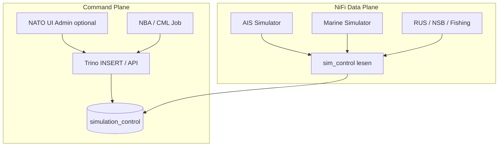

# Implementierungsplan: Aktive Steuerung der NiFi-Simulatoren (Simulation Control)

Stand: November 2026 · Repository: **Triton Baltic Sea Observer**  
Verwandt: [NiFi Processors](../nifi-processors/README.md) · [NBA UC2](../cai-workbench/next-best-action/IMPLEMENTIERUNGSPLAN.md) · [Mission Einsatz (NBA → NiFi)](IMPLEMENTIERUNGSPLAN_MISSION_EINSATZ_SIMULATION.md) · [SAP MP](IMPLEMENTIERUNGSPLAN_MISSION_SAP.md) · [LiDAR Disk](../nifi-processors/docs/LIDAR_NIFI_DISK.md)

## 1. Ziele und Abgrenzung

| Ziel | Beschreibung |
| :---- | :---- |
| **Szenario-Umschaltung** | Operator oder NBA setzt Modus: Standardfahrt, Vollstopp, Anker suchen, vor Anker, Fahrt Heimathafen — **ohne** NiFi-Flow-Neuaufbau |
| **Audit** | Jeder Moduswechsel mit `command_id`, Zeit, Aussteller, betroffene `fleet_scope` |
| **Fleet-Scoped** | `ais`, `marine`, `rus`, `nsb`, `fishing`, `all` — unabhängig voneinander oder global |

| Nicht in Scope (Phase 0–2) | Begründung |
| :---- | :---- |
| Echtzeit-Replikation AIS von außerhalb CDP | weiterhin **Simulatoren** als Datenquelle |
| LiDAR-Inhalt pro Schiff | LiDAR nur **Pause/Rate**; kein Schiffs-Follow |
| SAP Force-Element-Befehle | MP-Plan: später **Event** nach HITL, nicht NiFi direkt |
| Multi-Node-NiFi ohne Shared Store | Phase 4; bis dahin **ein** NiFi-Cluster oder Trino als Command-Store |

## 2. Ist-Stand (November 2026)

| Baustein | Pfad / Verhalten |
| :---- | :---- |
| Zivil-AIS | `nifi-processors/upload/ShipSimulationRoutesGemini.py`, State `/tmp/ship_state.json` |
| Marine / STANAG | `MarineShipSimulator.py`, `STANAGSimulator.py`, `/tmp/marineship_state.json` |
| RUS / NSB / Fishing | `RusFleetPositionSimulator.py`, `NorthSeaBalticTradeSimulator.py`, `FishingBoatSimulator.py` |
| Route-Attribut | FlowFile `ship.simulation.route` |
| Grob-Reset | `BalticShipRouteStateReset.py` — Datei löschen oder `RouteWaypoints` leeren |
| Wasser / Routing | `baltic_water_placement.py`, `baltic_ship_routing.py` |
| Persistenz AIS | Iceberg `ais_events_ice`, `marine_vessel_status` (NiFi → PutIceberg) |

**Lücke:** Kein gemeinsames **Kommando-Signal** pro Tick; Szenarien nur durch Stop/Reset erreichbar.

## 3. Zielbild



**Prinzip:** NiFi bleibt **Timer/Scheduler**; **Semantik** der Bewegung liegt in Python (`sim_command.py` + bestehende Engines). Ein **aktiver Befehl** pro `fleet_scope` (oder global `all`) überschreibt das Tick-Verhalten.

## 4. Kommando-Vokabular (verbindlich Phase 0+)

| `command` | Kurzbeschreibung | AIS/Marine-Technik |
| :---- | :---- | :---- |
| `RUN_STANDARD` | Default: heutige Routen/Missionen | unveränderte Engine-Logik |
| `HOLD_ALL` | Alle betroffenen Schiffe: Position einfrieren, `sog=0` | keine Koordinatenänderung; konsistente NAV-Status-Felder |
| `SEEK_ANCHORAGE` | Route zu nächstem **sicheren Ankerpunkt** (Wasser, Abstand Restricted) | einmalig Waypoints setzen → danach `ANCHORED` |
| `ANCHORED` | Vor Anker (minimaler Drift optional) | keine neuen Routen |
| `RESUME_HOME` | Heimathafen aus Registry, Route neu planen | `marine_fleet_registry`, RUS/Fishing/NSB home |
| `RESET_ROUTES` | Entspricht Reset „nur Routen“ | wie `clear_route_fields` in `baltic_ship_sim_state.py` |
| `LIDAR_PAUSE` | nur LiDAR-Gruppe | GenerateFlowFile stoppen oder Rate 0 (NiFi-Flow, kein AIS-State) |

**Parameter (JSON in `parameters_json`):**

```json
{
  "mmsi_allowlist": ["211234567"],
  "mmsi_denylist": [],
  "anchor_search_radius_km": 25,
  "max_speed_kn_during_resume": 12,
  "reason": "OPORD fragment / NBA COA id"
}
```

## 5. Command Store (empfohlen: Trino / Iceberg)

### 5.1 Tabelle `iceberg.defense.simulation_control`

| Spalte | Typ | Bedeutung |
| :---- | :---- | :---- |
| `command_id` | VARCHAR | UUID, PK |
| `fleet_scope` | VARCHAR | `ais` \| `marine` \| `rus` \| `nsb` \| `fishing` \| `all` |
| `command` | VARCHAR | siehe Abschnitt 4 |
| `parameters_json` | VARCHAR | optional |
| `effective_from` | TIMESTAMP(6) | Gültig ab |
| `effective_until` | TIMESTAMP(6) | NULL = bis Widerruf |
| `issued_by` | VARCHAR | User / `nba` / `system` |
| `issued_at` | TIMESTAMP(6) | Audit |
| `supersedes_command_id` | VARCHAR | optional Kette |
| `active` | BOOLEAN | nur eine aktive Zeile pro `fleet_scope` empfohlen |

**DDL:** `cdw-analyse/sql/nba_schema_sim_control.sql` (neu, Phase 0).

**Lesen (Simulator):**

```sql
SELECT command, parameters_json, command_id
FROM iceberg.defense.simulation_control
WHERE active = true
  AND fleet_scope IN (?, 'all')
  AND effective_from <= CURRENT_TIMESTAMP
  AND (effective_until IS NULL OR effective_until > CURRENT_TIMESTAMP)
ORDER BY CASE fleet_scope WHEN 'all' THEN 0 ELSE 1 END, issued_at DESC
LIMIT 1;
```

**Schreiben:** `INSERT` + vorher `UPDATE … SET active = false WHERE fleet_scope = ?` (in CML-Job oder kleinem REST in NATO UI).

### 5.2 Fallback ohne Trino (ein NiFi-Knoten)

- Datei `/tmp/triton_sim_command.json` oder Parameter Context `TRITON_SIM_COMMAND`.
- Nur für Dev/Demo; **Produktion = Iceberg**.

## 6. Software-Lieferobjekte (Repository)

| Phase | Artefakt | Pfad |
| :---- | :---- | :---- |
| 0 | DDL + README | `cdw-analyse/sql/nba_schema_sim_control.sql`, Abschnitt in `cdw-analyse/README.md` |
| 0 | Kernmodul | `nifi-processors/upload/sim_command.py` |
| 0 | AIS-Anbindung | Patch `ShipSimulationRoutesGemini.py` — `HOLD_ALL`, `RUN_STANDARD` |
| 1 | Marine + STANAG | `MarineShipSimulator.py`, Dokumentation STANAG-Fallback |
| 1 | `RESUME_HOME` | Nutzung `german_navy_mission_engine` / Registry |
| 2 | `SEEK_ANCHORAGE` | `sim_anchor_planner.py` — Wasser-Maske, Mindestdistanz Restricted (später EMODNET Tier-A aus Trino-Cache) |
| 2 | RUS / NSB / Fishing | dieselbe `resolve_command(fleet=…)` |
| 3 | Command-Processor NiFi optional | `SimulationControlIngress.py` — HTTP POST → Trino JDBC oder Append-Job |
| 3 | NBA-Trigger | `cai-workbench/next-best-action` — Business Rule → `INSERT simulation_control` |
| 3 | UI (optional) | `triton-nato-ui` — Admin-Tab „Simulation“ nur mit Rolle Writer |
| 4 | Multi-Node | Redis oder nur Trino; kein `/tmp`-Broadcast |

### 6.1 Erweiterung Ship-State (pro Schiff)

Optionale Felder in `/tmp/*_state.json` (abwärtskompatibel):

```json
{
  "MMSI": "211234567",
  "Latitude": 54.1,
  "simPhase": "underway",
  "activeCommandId": "uuid",
  "holdSinceUtc": null
}
```

`simPhase`: `underway` \| `hold` \| `seeking_anchor` \| `anchored` \| `returning_home`

## 7. NiFi-Flow (CDP Data Flow)

| Aktion | Empfehlung |
| :---- | :---- |
| Simulatoren | **unverändert** timer-getrieben; nur Python-Code erweitert |
| Neue PG **Simulation Control** (optional Phase 3) | `ListenHTTP` POST `/sim/command` → Validate JSON → Trino Put / InvokeScript |
| LiDAR | `LIDAR_PAUSE`: Process Group disabled oder GenerateFlowFile Schedule 0 — siehe [LIDAR_NIFI_DISK.md](../nifi-processors/docs/LIDAR_NIFI_DISK.md) |
| Grob-Stop | Process Group **stopped** bleibt Wartungsschalter (Disk, Deploy) |

Kein Merge großer FlowFiles für Commands — nur Metadaten.

## 8. Phasenplan

### Phase 0 — Fundament (MVP)

**Ziel:** `HOLD_ALL` und `RUN_STANDARD` für **AIS** (`fleet_scope=ais`).

| # | Aufgabe | Akzeptanz |
| :-- | :---- | :---- |
| 0.1 | DDL `simulation_control` anwenden | Tabelle in Trino sichtbar |
| 0.2 | `sim_command.py` mit Trino-Lese-Cache (TTL 30 s) | Unit-Test mit Mock-JDBC |
| 0.3 | AIS-Simulator: bei `HOLD_ALL` keine Positionsupdates | `ais_events_ice` zeigt gleiche Position, `sog=0` |
| 0.4 | CML-Snippet oder SQL-Datei `set_sim_command_hold.sql` | Operator kann INSERT ausführen |
| 0.5 | Doku in `nifi-processors/README.md` verlinken | — |

### Phase 1 — Marine & Heimathafen

| # | Aufgabe | Akzeptanz |
| :-- | :---- | :---- |
| 1.1 | `MarineShipSimulator` + `fleet_scope=marine` | STANAG-Positionen konsistent bei HOLD |
| 1.2 | `RESUME_HOME` für Marine (Kiel/Wilhelmshaven/…) | Nach Command: neue Route zum `home_port` |
| 1.3 | `RESET_ROUTES` pro Scope ohne volles Datei-Delete | wie heutiger `clear_route_fields` |

### Phase 2 — Anker & weitere Flotten

| # | Aufgabe | Akzeptanz |
| :-- | :---- | :---- |
| 2.1 | `sim_anchor_planner.py` + `SEEK_ANCHORAGE` | Ankerposition nur auf Wasser, außerhalb definierter Restricted-Buffer |
| 2.2 | `ANCHORED` / Übergang von SEEK | Phase-Wechsel in `simPhase` |
| 2.3 | RUS, NSB, Fishing binden | gleiches Command-Modell |
| 2.4 | Optional: Layer „sichere Ankerzonen“ aus `cdw-analyse/trino-spatial-ais/` (EMODNET) | — |

### Phase 3 — Operative Anbindung

| # | Aufgabe | Akzeptanz |
| :-- | :---- | :---- |
| 3.1 | NBA: COA / Rule `RUS_FLEET_DEESCALATION` → `INSERT HOLD_ALL` | Nachweis in `simulation_control.issued_by='nba'` |
| 3.2 | NATO UI: POST `/api/simulation/command` (intern Trino) | Nur mit Auth / Projekt-Writer |
| 3.3 | NiFi `SimulationControlIngress` oder externes Skript | Dry-Run + Audit |

### Phase 4 — Skalierung & Härte

| # | Aufgabe |
| :-- | :---- |
| 4.1 | Mehrere NiFi-Nodes: ausschließlich Trino/Redis Command-Store |
| 4.2 | Idempotenz `command_id`, Wiederholung sicher |
| 4.3 | Integration MP/SAP: **nach** HITL-Freigabe CloudEvent, nicht direkt NiFi |

## 9. Tests

| Ebene | Ort |
| :---- | :---- |
| Unit | `nifi-processors/tests/test_sim_command.py` — Auflösung `all` vs `ais`, TTL-Cache |
| Unit | `test_sim_anchor_planner.py` — Wasser vs Land |
| Integration | Session ohne NiFi: State-JSON laden, `apply_command(HOLD_ALL)` zweimal ticken → gleiche Lat/Lon |
| Regression | Bestehende `test_baltic_ship_routing.py`, `benchmark_*` bei `RUN_STANDARD` unverändert grün |
| E2E (manuell) | INSERT `HOLD_ALL` → 5 min AIS → Trino `MAX(sog)=0` für betroffene MMSIs |

## 10. Risiken und Mitigation

| Risiko | Mitigation |
| :---- | :---- |
| Trino auf NiFi-Knoten nicht erreichbar | Fallback `RUN_STANDARD`; Log-Warnung |
| `/tmp` nur lokal pro Pod | Command-Store **nie** nur in `/tmp` in Prod |
| HOLD vergessen → stale Lage | `effective_until` + UI-Anzeige aktiver Commands |
| SEEK_ANCHORAGE auf Land | Zwingend `baltic_water_placement` / Polygon-Test |
| Disk full (LiDAR) | `LIDAR_PAUSE` in Incident-Runbook koppeln |

## 11. Environment / Betrieb

| Variable | Wo | Zweck |
| :---- | :---- | :---- |
| `TRINO_*` | NiFi Processor / Parameter Context | JDBC für `simulation_control` |
| `SIM_CONTROL_CACHE_SEC` | optional, default 30 | Trino-Last reduzieren |
| `SIM_CONTROL_FALLBACK` | `RUN_STANDARD` | bei DB-Fehler |

Projekt-Env-Template: Eintrag in `.env.default` (nur Namen, keine Secrets):

```bash
# SIM_CONTROL_FALLBACK=RUN_STANDARD
# SIM_CONTROL_CACHE_SEC=30
```

## 12. Akzeptanz gesamt (Release-Kriterium Phase 0–1)

1. Operator setzt per SQL `HOLD_ALL` für `ais` → innerhalb **2 Simulator-Ticks** keine Positionsänderung in Iceberg.
2. `RUN_STANDARD` hebt HOLD ohne Reset-Datei auf.
3. `RESUME_HOME` (Marine) erzeugt Route zum dokumentierten Heimathafen.
4. Audit: letzte 10 Zeilen in `simulation_control` nachvollziehbar.
5. Bestehende Showcase-Flows ohne Änderung der **Verbindungen** deploybar (nur Extension-Reload).

## 13. Nächste Schritte (sofort umsetzbar)

1. Branch `cursor/sim-control-phase0-bcfe`: DDL + `sim_command.py` + AIS `HOLD_ALL`.
2. `cdw-analyse/run_trino_ddl.py` um Sim-Control-Skript erweitern.
3. PR mit Verweis von `README.md` und `nifi-processors/upload/README.md`.

---

*Dieses Dokument beschreibt die verbindliche Reihenfolge; Details zu Polygon-Daten und UI-Mockups können in Unter-Docs (`docs/SIM_CONTROL_UI.md`) ergänzt werden, sobald Phase 3 startet.*