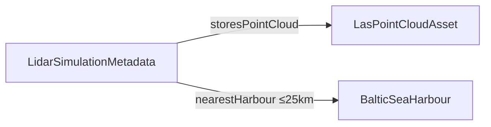

# Triton defense ontology

Semantic layer for CDW Iceberg tables, NiFi attributes, and CDV dashboards.

## Layout

| Path | Purpose |
|------|---------|
| `triton_defense_ontology.yaml` | Object types + inline properties |
| **`graph.yaml`** | **Link types** (graph edges) between object types |
| **`mappings/lidar_simulation_metadata.yaml`** | **Column ↔ property** mapping for LiDAR metadata |
| `enums/lidar_classification_codes.yaml` | LAS class code → vessel type |
| `../cdv/datasets/LidarSimulationMetadata.dataset.json` | CDV dataset stub (`dataset_info` column list) |

## Relationship graph (LiDAR)



Full join rules: `graph.yaml`.

## LiDAR table

```sql
-- cdw-analyse/lidar_simulation_metadata_impala.sql
defense.lidar_simulation_metadata
```

## CDV

1. Create dataset from **`defense.lidar_simulation_metadata`** (or import `cdv/datasets/LidarSimulationMetadata.dataset.json` fields into your workspace).
2. Map click → application parameters per `mappings/lidar_simulation_metadata.yaml` (`lidar_*` names).
3. HTML panel: `cdv/lidar_metadata_iris_style_example.html`.

## NiFi attribute map (quick reference)

| Iceberg column | NiFi attribute |
|----------------|----------------|
| `hadoop_file_url` | `hadoop.file.url` |
| `center_lat` / `center_lon` | `lidar.center.lat` / `lidar.center.lon` |
| `classification` | `lidar.classification` |
| `filename` | `lidar.filename` |
| `heading_deg` | `lidar.heading_deg` |
| `point_count` | `lidar.point_count` |
| `vessel_name` | `lidar.vessel_name` |
| `vessel_type` | `lidar.vessel_type` |
