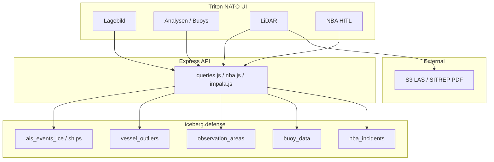

# Triton NATO UI — data & main views

The app is a single-page application (`#hash` routes) backed by **Express** (`server/index.js`) and warehouse bridges (**Trino** preferred, **Impala** fallback, **embedded sample** when offline). Status bar: **DATA FEED OK** vs **SAMPLE DATA** (`GET /api/health`).

## Navigation map

| Zone (hash) | Label | Primary purpose |
|-------------|-------|-----------------|
| *(default)* | **Lagebild** | Operational map + KPIs + 24h tracks |
| `#analysen` | **Analysen** | Aggregated analytics (fleet, buoys, RUS, AIS, sanctions, restricted) |
| `#lidar` | **LiDAR** | Scan catalog + point-cloud preview (S3 LAS/LAZ) |
| `#das` | **DAS Kabel** | Segment catalog + spectrogram/audio preview (S3 HDF5 or demo); footer build ≥ `0.2.1-das-preview` |
| `#sitrep` | **SITREP** | PDF/text reports from S3 (`LAGEBILD_S3_PREFIX`) |
| `#agents` | **Agenten** | CrewAI chat apps + Semantica ontology (`#sql` redirects here) |
| `#nba` | **NBA HITL** | Next Best Action incidents, COA matrix, decision recorder |

Shared **Filter Rail** (flag, vessel type, ship name) applies to **Lagebild** and **Analysen** where noted.

---

## Agenten console

| Endpoint | Purpose |
|----------|---------|
| `GET /api/agents/apps` | Lage-Analyst, COA-Berater, Semantica-Kurator |
| `GET /api/agents/ontology` | `baltic_ontology.json` concepts + rulebook refs |
| `POST /api/agents/chat` | `{ app_id, messages[] }` → Python `chat_bridge.py` (CrewAI / LLM / offline) |
| `GET /api/agents/business-rules` | NATO business rules + `baltic_trino_mapping.json` entity map |

Ontology path: `cai-workbench/next-best-action/data/baltic_ontology.json`. Override with `TRITON_ONTOLOGY_PATH`.

---

## 1 · Lagebild (main situation picture)

**Goal:** One Baltic operations picture — who is where, what is anomalous, where infrastructure and restricted areas are, and where NBA cases sit.

### Header KPIs (`GET /api/kpis`)

| KPI | Warehouse | Meaning |
|-----|-----------|---------|
| Flotte | `german_navy_fleet` | Registered DE naval units (count) |
| Personal | `german_navy_fleet` | Sum of crew strengths |
| Surveillance | `marine_surveillance_reports` | Situation reports (sim + live) |
| Alerts | `vessel_outliers` (24h, severity ≥ 70) | High AIS anomalies |
| *(in Alerts tile)* | `nba_incidents` | NBA case count (`GET /api/nba/incidents`) |

### Map layers (toggles)

| Layer | API / table | Content |
|-------|-------------|---------|
| AIS Live | `/api/ais` | Latest AIS positions (`ships` / live AIS view) |
| DEU / RUS Fleet | `/api/fleet-positions` | `german_navy_fleet` + `rus_fleet` positions |
| AIS Outliers | `/api/vessel-outliers` | `vessel_outliers` (Trino detection job) |
| Route tracks 24h · Zeitachse | `/api/position-tracks` | `ais_events_ice`, DE/RUS fleet history; max 10 objects, time slider |
| Restricted Areas | `/api/observation-areas` | Tier-A `observation_areas` (EMODnet military) |
| Pipelines & Cables | `/api/ostsee-infrastructure` | `ostsee_infrastruktur`, `ostsee_pipelines` |
| NBA incidents | `/api/nba/incidents` | Markers → click opens **#nba** for `flow_uuid` |
| Sanctions overlay | AIS join | Sanctioned flag on tracks |

### Below the map

- **Position tracks** mini-map (when enabled): same track bundle as layer above.

**Integration:** Feeds UC1 situation-awareness indirectly (same `defense` schema); SITREP escalation can spawn NBA (`sitrep_escalation`).

---

## 2 · Analysen — Buoys tab

**Goal:** MAD/buoy sensor analytics for dark-vessel and classification workflows.

| Panel | API | Source tables |
|-------|-----|----------------|
| Map | `/api/analyses/buoy-analytics` | `buoy_data` (+ aggregations) |
| KPI / time series / scatter | same payload | Detection counts, confidence, types |

**Buoy map:** `BuoyAnalyticsMap` — geographic buoy positions and linked metrics.

Other **Analysen** tabs (same page, for context):

- **Fleet** — DE fleet analytics  
- **RUS Fleet** — `rus_fleet`, restricted-area presence  
- **AIS** — filtered AIS analytics  
- **Sanctions** — sanctioned vessel analytics  
- **Restricted Areas** — tracks in Tier-A AOIs (`observation_areas`)

---

## 3 · LiDAR

**Goal:** Inspect geospatial LiDAR captures tied to vessel / grid box workflows.

| UI block | API | Backend |
|--------|-----|---------|
| Scan table | `GET /api/lidar/scans` | Metadata from warehouse + sample fallback |
| DAS segments | `GET /api/das-cable/segments` | `das_cable_spectrogram_metadata` + sample fallback |
| DAS spectrogram + audio | `GET /api/das-cable/preview?hadoop_file_url=&segment_index=` | `das-h5-bridge.py` (HDF5 in S3; **≤10 s** WAV + downsampled spectrogram) |
| Point preview | `GET /api/lidar/points?...` | `lidar-las-bridge.py` reads LAS/LAZ from **S3** (`S3_WORKLOAD_*`, optional prefix allowlist) |
| Map | `LidarMap` | Scan footprint / bbox |

Requires S3 credentials on CML for live clouds; otherwise sample scans.

---

## 4 · NBA HITL (`#nba`)

**Goal:** Human approval of **Course of Action (COA)** for incidents produced by `cai-workbench/next-best-action`.

| UI block | API | Trino / artifacts |
|----------|-----|-------------------|
| Incident list | `/api/nba/incidents` | `nba_incidents` |
| COA matrix | `/api/nba/incidents/:uuid/coa-runs` | `nba_coa_runs` or `decision_record_json` |
| Decision recorder (9 §) | `/api/nba/incidents/:uuid/decision-record` | JSON sections 1–9 (lage, data pin, sim, scenario matrix, red/blue, …) |
| Approve | `POST .../approve` | Updates `approved_coa_id`, status |
| Phase 7 / 8 links | governance-bundle, semantica-record | `governance_bundle.json`, `semantica_record.json` |

**Lagebild link:** NBA layer shows incidents on the map; selection stores `flow_uuid` and navigates to HITL.

**Demo mode:** No `TRINO_*` → embedded `nba-sample.js` + bundled decision record (see root `.env.default` and README).

---

## Data integration diagram

---

## Performance (live Trino)

See **[API_LATENCY.md](./API_LATENCY.md)** and `scripts/bench-api-latency.mjs`.

## Related docs

- App deploy & env: [`../README.md`](../README.md)  
- CML env template: [`../../.env.default`](../../.env.default)  
- NBA pipeline: [`../../cai-workbench/next-best-action/README.md`](../../cai-workbench/next-best-action/README.md)  
- Outlier fill: [`../../cdw-analyse/README_outlier_detection_trino.md`](../../cdw-analyse/README_outlier_detection_trino.md)